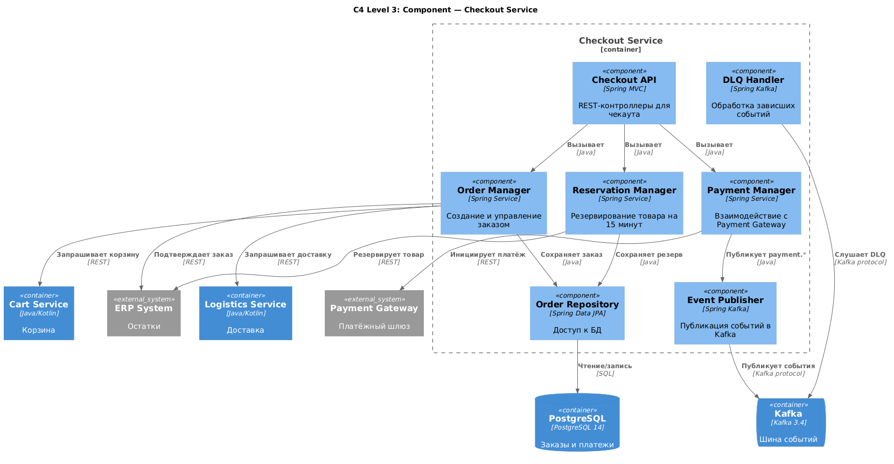

# 7. Архитектура системы (C4)

## 7.1. Назначение документа

Раздел описывает архитектуру системы оформления заказа с использованием модели **C4** (Context, Container, Component, Code). C4 позволяет показать систему на разных уровнях детализации:

- **Level 1 — Context:** система и её взаимодействие с внешним миром.
- **Level 2 — Container:** крупные технические блоки (микросервисы, БД, брокеры).
- **Level 3 — Component:** внутреннее устройство ключевого сервиса.
- **Level 4 — Code:** не рассматривается в этом документе.

Также раздел содержит:
- Описание каждого сервиса (роль, API, БД, зависимости).
- Технологические решения и обоснования.
- ADR (Architecture Decision Records) — почему выбрали именно эти технологии.

**Инструмент моделирования:** PlantUML (C4-PlantUML).
**Стандарт:** C4 model by Simon Brown.

---

## 7.2. Level 1 — System Context

### 7.2.1. Описание

Система «Checkout Platform» — это ядро оформления заказов в e-commerce. Она взаимодействует с внешними акторами (клиент, оператор) и внешними системами (Payment Gateway, ERP, WMS, курьерские службы).

### 7.2.2. Диаграмма C4 Context

Исходник: [architecture-context.puml](../diagrams/architecture-context.puml)

### 7.2.3. Акторы и системы

| Элемент | Тип | Описание |
|---------|-----|----------|
| Клиент | Person | Пользователь мобильного приложения или сайта |
| Оператор | Person | Сотрудник клиентского сервиса |
| Checkout Platform | System | Проектируемая система |
| Payment Gateway | External System | Внешний платёжный шлюз |
| ERP System | External System | Учёт остатков и заказов |
| WMS | External System | Управление складом |
| Courier Services | External System | Курьерские службы |
| Push/SMS Provider | External System | FCM, APNS, SMS-шлюз |

---
## 7.3. Level 2 — Container

### 7.3.1. Описание

Система «Checkout Platform» состоит из микросервисов, базы данных, брокера сообщений и API Gateway. Каждый контейнер — отдельно деплоимая единица.

### 7.3.2. Диаграмма C4 Container

Исходник: [architecture-container.puml](../diagrams/architecture-container.puml)

### 7.3.3. Контейнеры

| Контейнер | Технология | Роль |
|-----------|-----------|------|
| Web App | React | Веб-интерфейс интернет-магазина |
| Mobile App | iOS/Android | Мобильное приложение |
| API Gateway | Kong / NGINX | Точка входа, аутентификация, rate limiting |
| Cart Service | Java/Kotlin | Корзина, проверка остатков и цен |
| Checkout Service | Java/Kotlin | Оформление заказа, резервирование, платежи |
| Logistics Service | Java/Kotlin | Расчёт доставки, сплитование |
| Order Service | Java/Kotlin | Управление заказами и статусами |
| Notification Service | Java/Kotlin | Push/SMS/email-уведомления |
| PostgreSQL | PostgreSQL 14 | Основная БД |
| Redis | Redis 7 | Кэш и сессии |
| Apache Kafka | Kafka 3.4 | Шина событий |

---

## 7.4. Level 3 — Component (Checkout Service)

### 7.4.1. Описание
Checkout Service — центральный сервис оформления заказа. Внутри него выделены компоненты, каждый из которых отвечает за свою задачу.

### 7.4.2. Диаграмма C4 Component

Исходник: [architecture-component.puml](../diagrams/architecture-component.puml)

### 7.4.3. Компоненты Checkout Service

| Компонент | Роль |
|-----------|------|
| Checkout API | REST-контроллеры для эндпоинтов `/checkout/confirm`, `/checkout/cancel` |
| Order Manager | Создаёт заказ, управляет его жизненным циклом |
| Reservation Manager | Резервирует товар на 15 минут, управляет таймаутом |
| Payment Manager | Инициирует платёж, обрабатывает webhook от Payment Gateway |
| Event Publisher | Публикует события в Kafka (`order.created`, `order.confirmed`, `order.cancelled`) |
| DLQ Handler | Обрабатывает зависшие события из Dead-Letter Queue |
| Order Repository | Доступ к БД через Spring Data JPA |

---
## 7.5. Описание сервисов

### 7.5.1. Cart Service

| Параметр | Значение |
|----------|----------|
| **Роль** | Хранение корзины, проверка остатков и цен |
| **API** | `GET /cart`, `POST /cart/items`, `DELETE /cart/items/{id}`, `POST /cart/calculate` |
| **БД** | PostgreSQL (`carts`, `cart_items`) |
| **Кэш** | Redis (остатки и цены) |
| **Зависимости** | ERP, Redis, PostgreSQL |
| **События** | `cart.updated` |

### 7.5.2. Checkout Service

| Параметр | Значение |
|----------|----------|
| **Роль** | Оформление заказа, резервирование, платежи |
| **API** | `POST /checkout/confirm`, `POST /checkout/cancel`, `POST /payments/webhook` |
| **БД** | PostgreSQL (`orders`, `payments`) |
| **Зависимости** | Cart Service, Logistics Service, Payment Gateway, ERP, Kafka |
| **События** | `order.created`, `order.confirmed`, `order.cancelled`, `order.expired`, `payment.failed` |

### 7.5.3. Logistics Service

| Параметр | Значение |
|----------|----------|
| **Роль** | Расчёт доставки, сплитование заказов |
| **API** | `POST /logistics/calculate`, `POST /logistics/split` |
| **БД** | PostgreSQL (`deliveries`, `delivery_slots`) |
| **Зависимости** | WMS, Courier Services, ERP |
| **События** | `delivery.assigned`, `delivery.in_transit`, `delivery.delivered` |

### 7.5.4. Order Service

| Параметр | Значение |
|----------|----------|
| **Роль** | Управление заказами, статусами, историей |
| **API** | `GET /orders`, `GET /orders/{id}` |
| **БД** | PostgreSQL (`orders`, `order_items`, `order_status_history`) |
| **Зависимости** | Kafka, PostgreSQL |
| **События** | Подписка на `order.*` |

### 7.5.5. Notification Service

| Параметр | Значение |
|----------|----------|
| **Роль** | Push/SMS/email-уведомления |
| **API** | Внутренний (слушает Kafka) |
| **Зависимости** | Kafka, Push-провайдер, SMS-провайдер |
| **События** | Подписка на `order.*`, `payment.*`, `delivery.*` |

---

## 7.6. Технологические решения

### 7.6.1. Стек технологий

| Компонент | Технология | Обоснование |
|-----------|------------|-------------|
| Язык backend | Java / Kotlin | Зрелость, экосистема Spring, поддержка в команде |
| Фреймворк | Spring Boot | Стандарт индустрии, интеграция с Kafka, JPA |
| API Gateway | Kong / NGINX | Гибкость, rate limiting, аутентификация |
| БД | PostgreSQL 14 | ACID, JSONB, надёжность, партиционирование |
| Кэш | Redis 7 | Быстрый доступ, TTL, поддержка кластера |
| Брокер | Apache Kafka 3.4 | At-least-once, партиции, DLQ, экосистема |
| Мониторинг | Prometheus + Grafana | Стандарт, интеграция с Spring Actuator |
| Трейсинг | OpenTelemetry | Стандарт, поддержка Jaeger |
| Контейнеризация | Docker + Kubernetes | Масштабирование, отказоустойчивость |
| CI/CD | GitLab CI | Интеграция с репозиторием, гибкость |

### 7.6.2. Почему микросервисы, а не монолит

| Критерий | Монолит | Микросервисы |
|----------|---------|--------------|
| Масштабирование | Всё сразу | По сервисам |
| Деплой | Риск для всей системы | Независимый |
| Команды | Связаны | Автономны |
| Технологии | Единые | Разные |
| Отказоустойчивость | Падение = полный отказ | Изоляция сбоев |

**Решение:** микросервисы, потому что:
- Чекаут — критичный домен, требует отдельного масштабирования.
- Команды работают параллельно над разными сервисами.
- Изоляция сбоев: падение Notification не должно ронять чекаут.

---

## 7.7. ADR (Architecture Decision Records)

### ADR-01: Использование Kafka вместо RabbitMQ

**Контекст:** нужен брокер для асинхронного взаимодействия между сервисами.

**Решение:** Apache Kafka.

**Обоснование:**
- Гарантия at-least-once (критично для заказов).
- Партиционирование для масштабирования.
- Возможность replay событий (для аналитики).
- DLQ из коробки.
- Широкая экосистема (Kafka Connect, Streams).

**Альтернативы:**
- RabbitMQ — проще, но слабее для high-throughput.
- ActiveMQ — устаревший.

### ADR-02: PostgreSQL вместо NoSQL

**Контекст:** нужна БД для заказов, платежей, корзины.

**Решение:** PostgreSQL 14.

**Обоснование:**
- ACID-транзакции (критично для платежей).
- JSONB для гибких полей (адрес, габариты).
- Партиционирование для масштабирования.
- Надёжность и зрелость.

**Альтернативы:**
- MongoDB — нет ACID на уровне нескольких документов.
- Cassandra — сложнее в поддержке.

### ADR-03: Резервирование на 15 минут

**Контекст:** нужно защитить товар от продажи другому клиенту, пока первый оплачивает.

**Решение:** жёсткий резерв на 15 минут.

**Обоснование:**
- 15 минут — среднее время оплаты (по аналитике).
- Меньше — риск потерять клиента.
- Больше — риск «зависших» резервов.

**Альтернативы:**
- 10 минут — слишком мало.
- 30 минут — слишком много «зависших».

### ADR-04: Idempotency-Key для чекаута

**Контекст:** клиент может дважды нажать «Оплатить».

**Решение:** использовать `Idempotency-Key` в заголовке.

**Обоснование:**
- Защита от дублей заказов.
- Стандарт индустрии (Stripe, PayPal).
- Простая реализация на стороне сервиса.

### ADR-05: Circuit Breaker для внешних вызовов

**Контекст:** ERP и Payment Gateway могут быть недоступны.

**Решение:** Circuit Breaker (Resilience4j).

**Обоснование:**
- Быстрый fail вместо таймаутов.
- Автоматическое восстановление.
- Защита от каскадных сбоев.

### ADR-06: DLQ для зависших событий

**Контекст:** события Kafka могут не обрабатываться.

**Решение:** Dead-Letter Queue.

**Обоснование:**
- Изоляция «ядовитых» сообщений.
- Возможность ручного разбора.
- Алерт дежурному инженеру.
---

## 7.8. Диаграмма развёртывания (Deployment)

