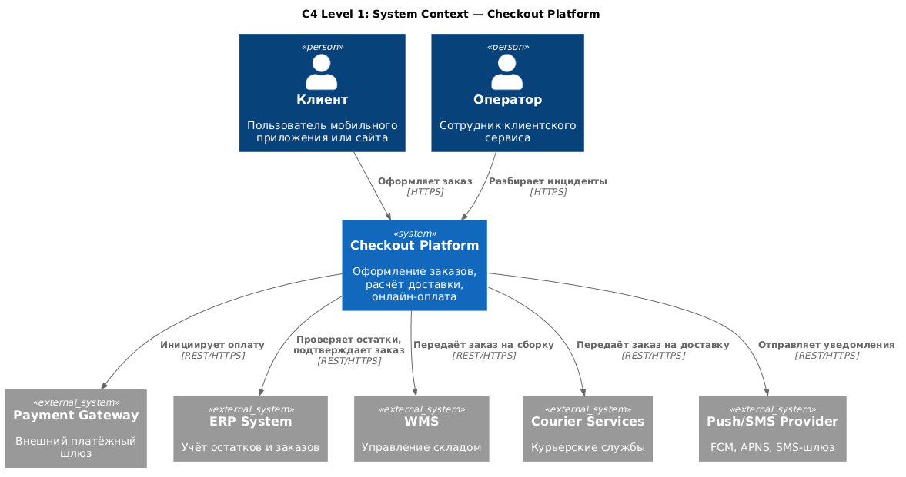
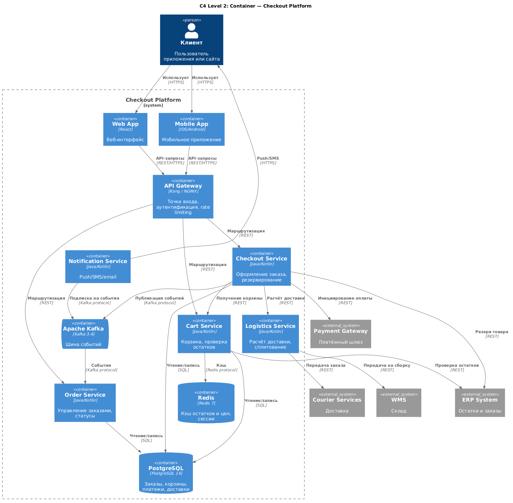

# 7. Архитектура системы (C4)

## 7.1. Назначение документа

Раздел описывает архитектуру системы оформления заказа с использованием модели **C4** (Context, Container, Component, Code). C4 позволяет показать систему на разных уровнях детализации:

- **Level 1 — Context:** система и её взаимодействие с внешним миром.
- **Level 2 — Container:** крупные технические блоки (микросервисы, БД, брокеры).
- **Level 3 — Component:** внутреннее устройство ключевого сервиса.
- **Level 4 — Code:** не рассматривается в этом документе.

Также раздел содержит:
- Описание каждого сервиса (роль, API, БД, зависимости).
- Технологические решения и обоснования.
- ADR (Architecture Decision Records) — почему выбрали именно эти технологии.

**Инструмент моделирования:** PlantUML (C4-PlantUML).
**Стандарт:** C4 model by Simon Brown.

---

## 7.2. Level 1 — System Context

### 7.2.1. Описание

Система «Checkout Platform» — это ядро оформления заказов в e-commerce. Она взаимодействует с внешними акторами (клиент, оператор) и внешними системами (Payment Gateway, ERP, WMS, курьерские службы).

### 7.2.2. Диаграмма C4 Context

Исходник: [architecture-context.puml](../diagrams/architecture-context.puml)

### 7.2.3. Акторы и системы

| Элемент | Тип | Описание |
|---------|-----|----------|
| Клиент | Person | Пользователь мобильного приложения или сайта |
| Оператор | Person | Сотрудник клиентского сервиса |
| Checkout Platform | System | Проектируемая система |
| Payment Gateway | External System | Внешний платёжный шлюз |
| ERP System | External System | Учёт остатков и заказов |
| WMS | External System | Управление складом |
| Courier Services | External System | Курьерские службы |
| Push/SMS Provider | External System | FCM, APNS, SMS-шлюз |

---
## 7.3. Level 2 — Container

### 7.3.1. Описание

Система «Checkout Platform» состоит из микросервисов, базы данных, брокера сообщений и API Gateway. Каждый контейнер — отдельно деплоимая единица.

### 7.3.2. Диаграмма C4 Container

Исходник: [architecture-container.puml](../diagrams/architecture-container.puml)

### 7.3.3. Контейнеры

| Контейнер | Технология | Роль |
|-----------|-----------|------|
| Web App | React | Веб-интерфейс интернет-магазина |
| Mobile App | iOS/Android | Мобильное приложение |
| API Gateway | Kong / NGINX | Точка входа, аутентификация, rate limiting |
| Cart Service | Java/Kotlin | Корзина, проверка остатков и цен |
| Checkout Service | Java/Kotlin | Оформление заказа, резервирование, платежи |
| Logistics Service | Java/Kotlin | Расчёт доставки, сплитование |
| Order Service | Java/Kotlin | Управление заказами и статусами |
| Notification Service | Java/Kotlin | Push/SMS/email-уведомления |
| PostgreSQL | PostgreSQL 14 | Основная БД |
| Redis | Redis 7 | Кэш и сессии |
| Apache Kafka | Kafka 3.4 | Шина событий |

---

## 7.4. Level 3 — Component (Checkout Service)

### 7.4.1. Описание
Checkout Service — центральный сервис оформления заказа. Внутри него выделены компоненты, каждый из которых отвечает за свою задачу.
