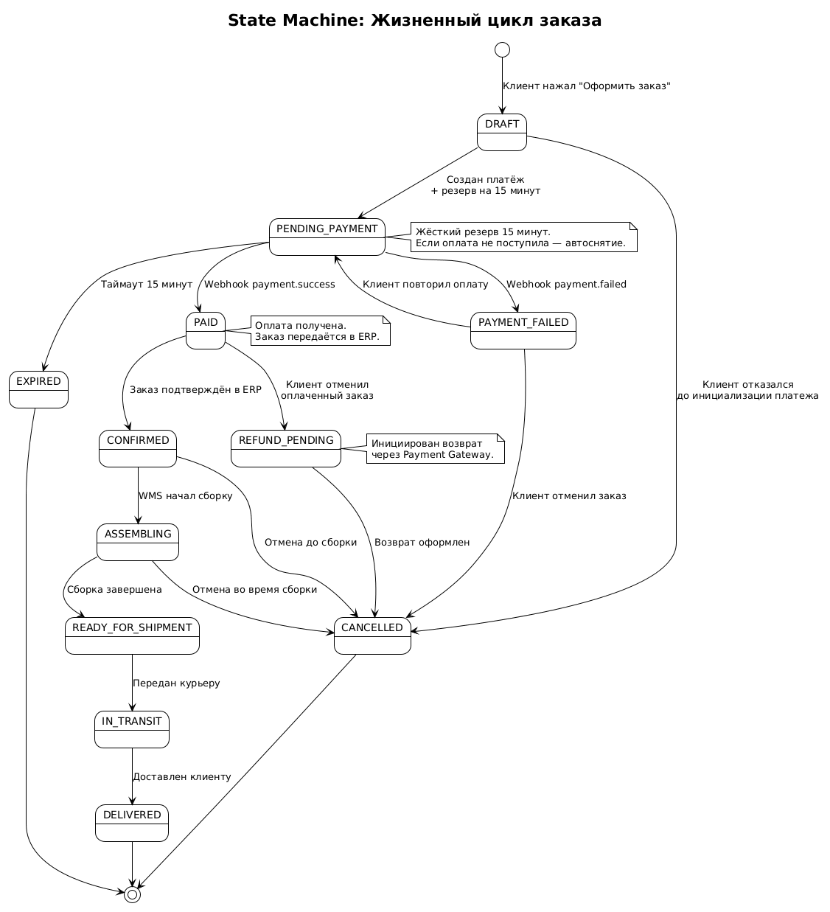
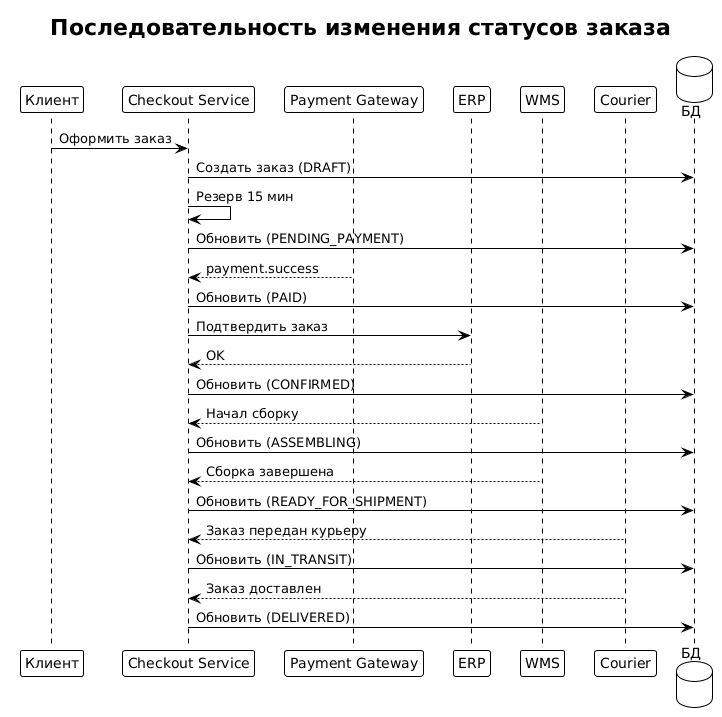

# 8. State Machine заказа

## 8.1. Назначение документа

Раздел описывает **жизненный цикл заказа** в системе оформления заказа — от создания черновика до финального статуса (доставлен, отменён, истёк). Документ содержит:

- Диаграмму состояний (State Machine) в PlantUML.
- Таблицу статусов заказа.
- Матрицу переходов (какие переходы разрешены).
- Триггеры и события, вызывающие переходы.
- Обработку исключительных ситуаций.
- Правила идемпотентности.

**Инструмент моделирования:** PlantUML.
**Стандарт:** UML State Machine.

---

## 8.2. Зачем нужна State Machine

Заказ — это долгоживущая сущность, которая проходит через множество состояний. Чёткая State Machine позволяет:

1. **Избежать невалидных переходов** — например, нельзя отменить заказ после передачи курьеру.
2. **Упростить логику** — разработчики знают, какие переходы разрешены.
3. **Обеспечить идемпотентность** — повторное событие не меняет статус, если он уже финальный.
4. **Улучшить мониторинг** — можно отслеживать заказы в «зависших» статусах.
5. **Упростить тестирование** — каждая ветка покрывается тест-кейсами.

---
## 8.3. Диаграмма состояний (State Machine)


Исходник: [state-machine.puml](../diagrams/state-machine.puml)

## 8.4. Статусы заказа

| Статус | Описание | Финальный? |
|--------|----------|------------|
| `DRAFT` | Черновик заказа. Создан, но оплата ещё не инициирована. | Нет |
| `PENDING_PAYMENT` | Ожидание оплаты. Товар зарезервирован на 15 минут. | Нет |
| `PAID` | Оплата получена. Ожидается подтверждение в ERP. | Нет |
| `CONFIRMED` | Заказ подтверждён в ERP, передан в WMS. | Нет |
| `ASSEMBLING` | WMS собирает заказ. | Нет |
| `READY_FOR_SHIPMENT` | Заказ собран, готов к передаче курьеру. | Нет |
| `IN_TRANSIT` | Заказ передан курьеру, в пути. | Нет |
| `DELIVERED` | Заказ доставлен клиенту. | **Да** |
| `PAYMENT_FAILED` | Оплата не прошла. Ожидает действия клиента. | Нет |
| `EXPIRED` | Резерв истёк, оплата не поступила. | **Да** |
| `CANCELLED` | Заказ отменён. | **Да** |
| `REFUND_PENDING` | Инициирован возврат средств. | Нет |

---

## 8.5. Матрица переходов (State Transition Matrix)

| Из \ В | DRAFT | PENDING_PAYMENT | PAID | CONFIRMED | ASSEMBLING | READY | IN_TRANSIT | DELIVERED | PAYMENT_FAILED | EXPIRED | CANCELLED | REFUND_PENDING |
|--------|-------|-----------------|------|-----------|------------|-------|------------|-----------|----------------|---------|-----------|----------------|
| **DRAFT** | — | ✅ | — | — | — | — | — | — | — | — | ✅ | — |
| **PENDING_PAYMENT** | — | — | ✅ | — | — | — | — | — | ✅ | ✅ | — | — |
| **PAID** | — | — | — | ✅ | — | — | — | — | — | — | — | ✅ |
| **CONFIRMED** | — | — | — | — | ✅ | — | — | — | — | — | ✅ | — |
| **ASSEMBLING** | — | — | — | — | — | ✅ | — | — | — | — | ✅ | — |
| **READY_FOR_SHIPMENT** | — | — | — | — | — | — | ✅ | — | — | — | — | — |
| **IN_TRANSIT** | — | — | — | — | — | — | — | ✅ | — | — | — | — |
| **DELIVERED** | — | — | — | — | — | — | — | — | — | — | — | — |
| **PAYMENT_FAILED** | — | ✅ | — | — | — | — | — | — | — | — | ✅ | — |
| **EXPIRED** | — | — | — | — | — | — | — | — | — | — | — | — |
| **CANCELLED** | — | — | — | — | — | — | — | — | — | — | — | — |
| **REFUND_PENDING** | — | — | — | — | — | — | — | — | — | — | ✅ | — |

**Легенда:**
- ✅ — переход разрешён.
- — — переход запрещён.
- Финальные статусы (`DELIVERED`, `EXPIRED`, `CANCELLED`) не имеют исходящих переходов.

---

## 8.6. Триггеры переходов

| Переход | Триггер | Источник | Публикуемое событие |
|---------|---------|----------|---------------------|
| DRAFT → PENDING_PAYMENT | Платёж инициирован, резерв создан | Checkout Service | `order.created` |
| DRAFT → CANCELLED | Клиент отказался до оплаты | Checkout Service | `order.cancelled` |
| PENDING_PAYMENT → PAID | Webhook `payment.success` | Payment Gateway | `payment.success` |
| PENDING_PAYMENT → PAYMENT_FAILED | Webhook `payment.failed` | Payment Gateway | `payment.failed` |
| PENDING_PAYMENT → EXPIRED | Таймаут 15 минут | Scheduler | `order.expired` |
| PAYMENT_FAILED → PENDING_PAYMENT | Клиент повторил оплату | Checkout Service | `payment.retry` |
| PAYMENT_FAILED → CANCELLED | Клиент отменил заказ | Checkout Service | `order.cancelled` |
| PAID → CONFIRMED | ERP подтвердил заказ | ERP | `order.confirmed` |
| PAID → REFUND_PENDING | Клиент отменил оплаченный заказ | Checkout Service | `order.cancelled` |
| CONFIRMED → ASSEMBLING | WMS начал сборку | WMS | `order.assembling` |
| ASSEMBLING → READY_FOR_SHIPMENT | Сборка завершена | WMS | `order.ready` |
| READY_FOR_SHIPMENT → IN_TRANSIT | Передан курьеру | Logistics Service | `delivery.in_transit` |
| IN_TRANSIT → DELIVERED | Доставлен клиенту | Courier Service | `delivery.delivered` |
| CONFIRMED → CANCELLED | Отмена до сборки | Checkout Service | `order.cancelled` |
| ASSEMBLING → CANCELLED | Отмена во время сборки | Checkout Service | `order.cancelled` |
| REFUND_PENDING → CANCELLED | Возврат оформлен | Payment Gateway | `refund.completed` |

---

## 8.7. Правила переходов (бизнес-правила)

| ID | Правило |
|----|---------|
| BR-SM-01 | Заказ не может перейти в `PAID` без подтверждения от Payment Gateway |
| BR-SM-02 | Заказ не может перейти в `CONFIRMED` без подтверждения от ERP |
| BR-SM-03 | Резерв действует 15 минут с момента `PENDING_PAYMENT` |
| BR-SM-04 | Отмена невозможна после `IN_TRANSIT` |
| BR-SM-05 | Возврат средств инициируется только при переходе в `REFUND_PENDING` |
| BR-SM-06 | Финальные статусы (`DELIVERED`, `EXPIRED`, `CANCELLED`) неизменяемы |
| BR-SM-07 | Повторное событие не меняет статус, если он уже финальный (идемпотентность) |
| BR-SM-08 | Переход в `PAYMENT_FAILED` не снимает резерв — он действует до таймаута |
| BR-SM-09 | При переходе в `EXPIRED` резерв снимается автоматически |
| BR-SM-10 | При переходе в `CANCELLED` после `PAID` обязателен возврат средств |

---

## 8.8. Обработка исключительных ситуаций

### 8.8.1. Дублирование события `payment.success`

**Ситуация:** Payment Gateway повторно отправляет webhook об успешной оплате.

**Обработка:**
1. Checkout Service проверяет текущий статус заказа.
2. Если статус уже `PAID` или выше — событие игнорируется.
3. Проверка идемпотентности по `payment_id`.
4. Возвращается `200 OK` шлюзу.

**Результат:** статус не меняется, дубль не создаётся.

### 8.8.2. Дублирование события `payment.failed`

**Ситуация:** Payment Gateway повторно отправляет webhook о неуспешной оплате.

**Обработка:**
1. Checkout Service проверяет статус заказа.
2. Если статус уже `PAYMENT_FAILED` — событие игнорируется.
3. Если статус `PENDING_PAYMENT` — переход в `PAYMENT_FAILED`.
4. Если статус выше `PAID` — событие игнорируется (нельзя откатить оплату).

### 8.8.3. Таймаут резерва при `PAYMENT_FAILED`

**Ситуация:** клиент не оплатил, статус `PAYMENT_FAILED`, но 15 минут ещё не истекли.

**Обработка:**
1. Scheduler проверяет все заказы в `PENDING_PAYMENT` и `PAYMENT_FAILED`.
2. Если `reservation_expires_at` < now — переход в `EXPIRED`.
3. Резерв снимается в ERP.
4. Публикуется `order.expired`.

### 8.8.4. Отмена после `IN_TRANSIT`

**Ситуация:** клиент пытается отменить заказ после передачи курьеру.

**Обработка:**
1. Checkout Service проверяет статус.
2. Если статус `IN_TRANSIT` или `DELIVERED` — отмена запрещена.
3. Возвращается `409 CANCELLATION_NOT_ALLOWED`.
4. Клиент получает сообщение с предложением оформить возврат после доставки.

### 8.8.5. Отмена оплаченного заказа

**Ситуация:** клиент отменяет заказ в статусе `PAID` или `CONFIRMED`.

**Обработка:**
1. Checkout Service переводит заказ в `REFUND_PENDING`.
2. Инициирует возврат через Payment Gateway.
3. Снимает резерв в ERP (если заказ ещё не отгружен).
4. Публикует `order.cancelled`.
5. После подтверждения возврата от Payment Gateway — переход в `CANCELLED`.

### 8.8.6. Зависшее событие в Kafka

**Ситуация:** событие `order.confirmed` не обрабатывается более 1 часа.

**Обработка:**
1. Kafka автоматически перемещает событие в DLQ.
2. Alert в PagerDuty.
3. Дежурный инженер разбирает инцидент вручную.
4. Если проблема в сервисе — после фикса событие переотправляется из DLQ.

---

## 8.9. Идемпотентность

### 8.9.1. Зачем нужна

Клиент может дважды нажать «Оплатить», webhook от Payment Gateway может прийти повторно, Kafka гарантирует **at-least-once** — то есть одно событие может быть доставлено несколько раз. Без идемпотентности это приведёт к дублям заказов и финансовым потерям.

### 8.9.2. Как обеспечивается

| Механизм | Где применяется |
|----------|-----------------|
| `Idempotency-Key` | Заголовок запроса `POST /checkout/confirm` |
| Уникальный ключ `order_id` | Ключ сообщения в Kafka |
| Проверка `payment_id` | Обработка webhook от Payment Gateway |
| Проверка текущего статуса | Перед любым переходом |
| Уникальный индекс в БД | `payments.external_id` |

### 8.9.3. Алгоритм обработки повторного запроса

```
1. Получить Idempotency-Key из заголовка.
2. Проверить в Redis: был ли уже такой ключ?
   - Если да — вернуть сохранённый результат.
   - Если нет — обработать запрос.
3. Сохранить результат в Redis с TTL = 24 часа.
4. Вернуть результат клиенту.
```

---

## 8.10. Хранение истории статусов

Каждый переход сохраняется в таблицу `order_status_history`.

| Поле | Тип | Описание |
|------|-----|----------|
| id | UUID | PK |
| order_id | UUID | FK → orders.id |
| from_status | VARCHAR(32) | Предыдущий статус |
| to_status | VARCHAR(32) | Новый статус |
| reason | VARCHAR(255) | Причина перехода |
| triggered_by | VARCHAR(64) | Кто инициировал (клиент, ERP, Payment Gateway) |
| created_at | TIMESTAMP | Дата перехода |

**Зачем:**
- Аудит действий.
- Разбор инцидентов.
- Аналитика по времени нахождения в статусах.
- Восстановление после сбоев.

---

## 8.11. Диаграмма последовательности изменения статусов



Исходник: [state-machine-sequence.puml](../diagrams/state-machine-sequence.puml)

