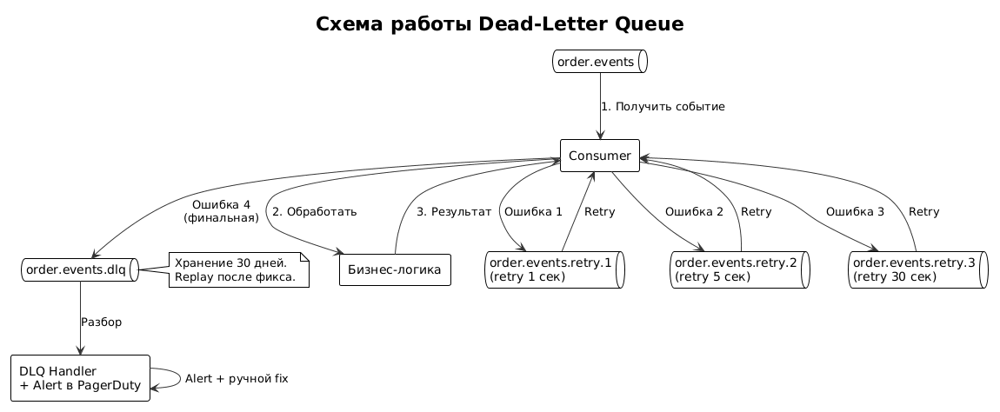
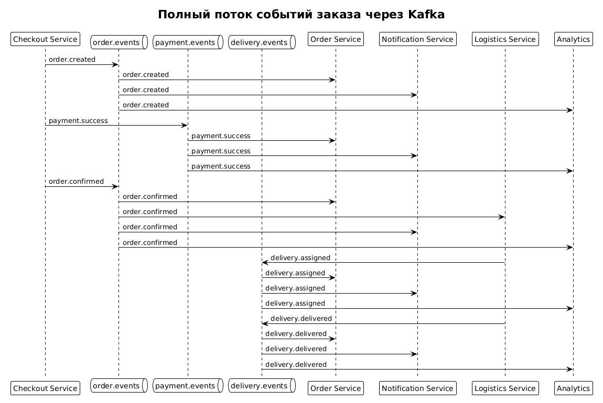

# 9. Kafka-события

## 9.1. Назначение документа

Раздел описывает событийную архитектуру системы оформления заказа. Все межсервисные взаимодействия, которые не требуют мгновенного ответа, реализованы через **Apache Kafka**. Документ содержит:

- Список топиков и их назначение.
- Схемы событий (форматы сообщений).
- Партиционирование и ключи сообщений.
- Гарантии доставки (at-least-once).
- Идемпотентность и защита от дублей.
- Dead-Letter Queue (DLQ) и обработка зависших событий.
- Retention и хранение.
- Мониторинг и алерты.

**Брокер:** Apache Kafka 3.4.
**Гарантия доставки:** at-least-once.
**Формат сообщений:** JSON (с возможностью перехода на Avro/Protobuf).

---

## 9.2. Зачем Kafka в этом проекте

| Проблема | Решение через Kafka |
|----------|---------------------|
| Синхронные вызовы ERP вызывают таймауты | Асинхронная публикация событий |
| Уведомления не должны блокировать чекаут | Отдельный сервис подписан на события |
| Логистика должна получать заказы независимо | Подписка на `order.confirmed` |
| Аналитика требует поток данных | Отдельный топик для BI |
| Сервис-получатель может быть недоступен | Kafka буферизует сообщения |

**Принципы:**
- **Асинхронность:** сервисы не ждут друг друга.
- **Слабая связанность:** publisher не знает о подписчиках.
- **Надёжность:** Kafka гарантирует доставку (at-least-once).
- **Масштабируемость:** партиции позволяют горизонтально масштабировать.

---

## 9.3. Список топиков

| Топик | Назначение | Партиции | Retention | Ключ |
|-------|-----------|----------|-----------|------|
| `order.events` | Все события заказа | 6 | 7 дней | `order_id` |
| `payment.events` | События платежей | 6 | 7 дней | `order_id` |
| `delivery.events` | События доставки | 6 | 7 дней | `order_id` |
| `notification.events` | События для уведомлений | 3 | 3 дня | `user_id` |
| `analytics.events` | События для аналитики | 12 | 30 дней | `order_id` |
| `order.events.dlq` | Мёртвые события заказов | 3 | 30 дней | `order_id` |
| `payment.events.dlq` | Мёртвые события платежей | 3 | 30 дней | `order_id` |
| `delivery.events.dlq` | Мёртвые события доставки | 3 | 30 дней | `order_id` |

### 9.3.1. Обоснование партиционирования

- **6 партиций** для `order.events` — позволяет обрабатывать до 6 сообщений параллельно.
- **12 партиций** для `analytics.events` — высокая нагрузка, требуется больше параллелизма.
- **3 партиции** для DLQ — низкая нагрузка, разбор вручную.
- **Ключ = `order_id`** — гарантирует порядок обработки событий одного заказа.

### 9.3.2. Обоснование retention

- **7 дней** — достаточно для replay и разбора инцидентов.
- **30 дней** для аналитики — нужно для построения отчётов.
- **DLQ хранится 30 дней** — чтобы успеть разобрать инциденты.

---

## 9.4. Схемы событий

### 9.4.1. Общая структура события (Event Envelope)

Все события используют единый формат-конверт:

```json
{
  "event_id": "uuid",
  "event_type": "order.created",
  "event_version": "1.0",
  "timestamp": "2026-10-13T12:00:00Z",
  "correlation_id": "uuid",
  "source": "checkout-service",
  "payload": { }
}
```

| Поле | Тип | Описание |
|------|-----|----------|
| `event_id` | UUID | Уникальный ID события (для идемпотентности) |
| `event_type` | String | Тип события (`order.created` и т.д.) |
| `event_version` | String | Версия схемы события |
| `timestamp` | ISO 8601 | Время создания |
| `correlation_id` | UUID | ID для трейсинга цепочки событий |
| `source` | String | Сервис-источник |
| `payload` | Object | Тело события (зависит от типа) |

### 9.4.2. События заказа (топик `order.events`)

#### `order.created`

```json
{
  "event_id": "e1e2e3e4-f5f6-7a8b-9c0d-1e2f3a4b5c6d",
  "event_type": "order.created",
  "event_version": "1.0",
  "timestamp": "2026-10-13T12:00:00Z",
  "correlation_id": "c1c2c3c4-d5d6-7e8f-9a0b-1c2d3e4f5a6b",
  "source": "checkout-service",
  "payload": {
    "order_id": "o1o2o3o4-p5q6-7r8s-9t0u-1v2w3x4y5z6a",
    "user_id": "u1u2u3u4-v5v6-7w8x-9y0z-1a2b3c4d5e6f",
    "total": 12470.00,
    "currency": "RUB",
    "items_count": 3,
    "status": "PENDING_PAYMENT",
    "reservation_expires_at": "2026-10-13T12:15:00Z"
  }
}
```

#### `order.confirmed`

```json
{
  "event_id": "e2e3e4e5-f6f7-8a9b-0c1d-2e3f4a5b6c7d",
  "event_type": "order.confirmed",
  "event_version": "1.0",
  "timestamp": "2026-10-13T12:05:00Z",
  "correlation_id": "c1c2c3c4-d5d6-7e8f-9a0b-1c2d3e4f5a6b",
  "source": "checkout-service",
  "payload": {
    "order_id": "o1o2o3o4-p5q6-7r8s-9t0u-1v2w3x4y5z6a",
    "erp_order_number": "LM-2026-00123456",
    "confirmed_at": "2026-10-13T12:05:00Z",
    "delivery": {
      "address": {
        "city": "Набережные Челны",
        "street": "Проспект Мира",
        "house": "10",
        "postal_code": "423800"
      },
      "slot_start": "2026-10-15T10:00:00Z",
      "slot_end": "2026-10-15T14:00:00Z",
      "courier_service": "CDEK"
    },
    "items": [
      {
        "product_id": "p1p2p3p4-q5q6-7r8s-9t0u-1v2w3x4y5z6a",
        "quantity": 2,
        "warehouse_id": "w1w2w3w4-x5x6-7y8z-9a0b-1c2d3e4f5a6b"
      }
    ]
  }
}
```

#### `order.cancelled`

```json
{
  "event_id": "e3e4e5e6-f7f8-9a0b-1c2d-3e4f5a6b7c8d",
  "event_type": "order.cancelled",
  "event_version": "1.0",
  "timestamp": "2026-10-13T12:30:00Z",
  "source": "checkout-service",
  "payload": {
    "order_id": "o1o2o3o4-p5q6-7r8s-9t0u-1v2w3x4y5z6a",
    "reason": "CUSTOMER_REQUEST",
    "refund_required": true,
    "refund_amount": 12470.00,
    "cancelled_at": "2026-10-13T12:30:00Z"
  }
}
```

#### `order.expired`

```json
{
  "event_id": "e4e5e6e7-f8f9-0a1b-2c3d-4e5f6a7b8c9d",
  "event_type": "order.expired",
  "event_version": "1.0",
  "timestamp": "2026-10-13T12:15:00Z",
  "source": "checkout-service",
  "payload": {
    "order_id": "o1o2o3o4-p5q6-7r8s-9t0u-1v2w3x4y5z6a",
    "reason": "RESERVATION_TIMEOUT",
    "expired_at": "2026-10-13T12:15:00Z"
  }
}
```

### 9.4.3. События платежа (топик `payment.events`)

#### `payment.success`

```json
{
  "event_id": "e5e6e7e8-f9f0-1a2b-3c4d-5e6f7a8b9c0d",
  "event_type": "payment.success",
  "event_version": "1.0",
  "timestamp": "2026-10-13T12:04:30Z",
  "source": "checkout-service",
  "payload": {
    "order_id": "o1o2o3o4-p5q6-7r8s-9t0u-1v2w3x4y5z6a",
    "payment_id": "p1p2p3p4-q5q6-7r8s-9t0u-1v2w3x4y5z6a",
    "amount": 12470.00,
    "currency": "RUB",
    "method": "CARD",
    "external_id": "pay_abc123xyz",
    "paid_at": "2026-10-13T12:04:30Z"
  }
}
```

#### `payment.failed`

```json
{
  "event_id": "e6e7e8e9-f0f1-2a3b-4c5d-6e7f8a9b0c1d",
  "event_type": "payment.failed",
  "event_version": "1.0",
  "timestamp": "2026-10-13T12:04:30Z",
  "source": "checkout-service",
  "payload": {
    "order_id": "o1o2o3o4-p5q6-7r8s-9t0u-1v2w3x4y5z6a",
    "payment_id": "p1p2p3p4-q5q6-7r8s-9t0u-1v2w3x4y5z6a",
    "amount": 12470.00,
    "reason": "INSUFFICIENT_FUNDS",
    "failed_at": "2026-10-13T12:04:30Z"
  }
}
```

#### `refund.completed`

```json
{
  "event_id": "e7e8e9e0-f1f2-3a4b-5c6d-7e8f9a0b1c2d",
  "event_type": "refund.completed",
  "event_version": "1.0",
  "timestamp": "2026-10-15T10:00:00Z",
  "source": "checkout-service",
  "payload": {
    "order_id": "o1o2o3o4-p5q6-7r8s-9t0u-1v2w3x4y5z6a",
    "refund_id": "r1r2r3r4-s5s6-7t8u-9v0w-1x2y3z4a5b6c",
    "amount": 12470.00,
    "currency": "RUB",
    "completed_at": "2026-10-15T10:00:00Z"
  }
}
```

### 9.4.4. События доставки (топик `delivery.events`)

#### `delivery.assigned`

```json
{
  "event_id": "e8e9e0e1-f2f3-4a5b-6c7d-8e9f0a1b2c3d",
  "event_type": "delivery.assigned",
  "event_version": "1.0",
  "timestamp": "2026-10-15T09:00:00Z",
  "source": "logistics-service",
  "payload": {
    "order_id": "o1o2o3o4-p5q6-7r8s-9t0u-1v2w3x4y5z6a",
    "delivery_id": "d1d2d3d4-e5e6-7f8g-9h0i-1j2k3l4m5n6o",
    "courier_service": "CDEK",
    "tracking_number": "CDEK1234567890",
    "assigned_at": "2026-10-15T09:00:00Z"
  }
}
```

#### `delivery.in_transit`

```json
{
  "event_id": "e9e0e1e2-f3f4-5a6b-7c8d-9e0f1a2b3c4d",
  "event_type": "delivery.in_transit",
  "event_version": "1.0",
  "timestamp": "2026-10-15T10:00:00Z",
  "source": "logistics-service",
  "payload": {
    "order_id": "o1o2o3o4-p5q6-7r8s-9t0u-1v2w3x4y5z6a",
    "delivery_id": "d1d2d3d4-e5e6-7f8g-9h0i-1j2k3l4m5n6o",
    "in_transit_at": "2026-10-15T10:00:00Z",
    "estimated_delivery": "2026-10-15T14:00:00Z"
  }
}
```

#### `delivery.delivered`

```json
{
  "event_id": "e0e1e2e3-f4f5-6a7b-8c9d-0e1f2a3b4c5d",
  "event_type": "delivery.delivered",
  "event_version": "1.0",
  "timestamp": "2026-10-15T13:45:00Z",
  "source": "logistics-service",
  "payload": {
    "order_id": "o1o2o3o4-p5q6-7r8s-9t0u-1v2w3x4y5z6a",
    "delivery_id": "d1d2d3d4-e5e6-7f8g-9h0i-1j2k3l4m5n6o",
    "delivered_at": "2026-10-15T13:45:00Z",
    "received_by": "Иванов И.И."
  }
}
```

---

## 9.5. Producer / Consumer Mapping

| Топик | Producer | Consumer |
|-------|----------|----------|
| `order.events` | Checkout Service | Order Service, Notification Service, Logistics Service, Analytics |
| `payment.events` | Checkout Service | Order Service, Notification Service, Analytics |
| `delivery.events` | Logistics Service | Order Service, Notification Service, Analytics |
| `notification.events` | Order Service | Notification Service |
| `analytics.events` | Все сервисы | Analytics Platform |
| `*.dlq` | Kafka (автоматически) | DLQ Handler, дежурный инженер |

---

## 9.6. Идемпотентность

### 9.6.1. Зачем нужна

Kafka гарантирует **at-least-once** — это значит, что одно сообщение может быть доставлено несколько раз. Без идемпотентности это приведёт к:

- Дублям заказов.
- Двойным списаниям.
- Двойным уведомлениям.
- Некорректной аналитике.

### 9.6.2. Механизмы защиты

| Механизм | Где применяется |
|----------|-----------------|
| `event_id` (UUID) | В конверте каждого события |
| Проверка в Redis | Consumer проверяет, было ли событие |
| Уникальный индекс в БД | `order_status_history.event_id` |
| Ключ сообщения = `order_id` | Гарантирует порядок |
| Идемпотентные операции | Consumer проверяет текущее состояние |

### 9.6.3. Алгоритм обработки события (idempotent consumer)

```
1. Получить событие из Kafka.
2. Извлечь event_id.
3. Проверить в Redis: обработано ли это событие?
   - Если да — commit offset и продолжить.
   - Если нет — обработать.
4. Выполнить бизнес-логику.
5. Сохранить event_id в Redis с TTL 7 дней.
6. Commit offset.
```

### 9.6.4. Гарантии порядка

- **Ключ сообщения = `order_id`.**
- Kafka гарантирует порядок **внутри партиции**.
- Все события одного заказа попадают в одну партицию.
- Это гарантирует, что `order.confirmed` не обработается раньше `order.created`.

---

## 9.7. Dead-Letter Queue (DLQ)

### 9.7.1. Зачем нужна

Иногда события не могут быть обработаны:
- Некорректный формат JSON.
- Ошибка в бизнес-логике.
- Недоступность внешней системы.
- Баг в consumer.

Без DLQ такие сообщения будут бесконечно ретраиться и блокировать очередь.

### 9.7.2. Схема работы


---

### 9.7.3. Политика ретраев

| Попытка | Задержка | Действие |
|---------|----------|----------|
| 1 | 1 сек | Retry |
| 2 | 5 сек | Retry |
| 3 | 30 сек | Retry |
| 4 | — | Отправка в DLQ |

**Retry-топики:**
- `order.events.retry.1` — задержка 1 сек.
- `order.events.retry.2` — задержка 5 сек.
- `order.events.retry.3` — задержка 30 сек.
- `order.events.dlq` — финальная точка.

### 9.7.4. Что попадает в DLQ

| Причина | Пример |
|---------|--------|
| Некорректный JSON | Сломанный формат события |
| Schema mismatch | Поле отсутствует или неверного типа |
| Бизнес-ошибка | Заказ не найден в БД |
| Внешняя система недоступна | ERP не отвечает 3 раза |
| Превышен таймаут | Обработка > 30 сек |

### 9.7.5. Обработка DLQ

1. **Автоматический Alert** в PagerDuty.
2. **Дашборд** в Grafana: количество событий в DLQ.
3. **Разбор вручную** дежурным инженером.
4. **Fix бага** и **replay** события обратно в основной топик.
5. **Аудит**: каждое событие в DLQ хранится 30 дней.

### 9.7.6. Метрики DLQ

| Метрика | Порог алерта |
|---------|--------------|
| Количество сообщений в DLQ | > 100 |
| Скорость роста DLQ | > 10/мин |
| Время нахождения в DLQ | > 24 часа |

---

## 9.8. Партиционирование и масштабирование

### 9.8.1. Стратегия партиционирования

| Топик | Ключ | Партиции | Обоснование |
|-------|------|----------|-------------|
| `order.events` | `order_id` | 6 | Порядок событий одного заказа |
| `payment.events` | `order_id` | 6 | Связь с заказом |
| `delivery.events` | `order_id` | 6 | Связь с заказом |
| `notification.events` | `user_id` | 3 | Порядок уведомлений пользователя |
| `analytics.events` | `order_id` | 12 | Высокая нагрузка |

### 9.8.2. Масштабирование consumer

- Один consumer может обрабатывать одну партицию.
- Максимум параллельных consumer = количество партиций.
- Для `order.events` — до 6 consumer-инстансов.
- При росте нагрузки — увеличиваем количество партиций.

### 9.8.3. Replication Factor

| Топик | Replication Factor |
|-------|-------------------|
| `order.events` | 3 |
| `payment.events` | 3 |
| `delivery.events` | 3 |
| `analytics.events` | 2 |
| `*.dlq` | 3 |

**Replication Factor = 3** означает, что каждое сообщение хранится на 3 брокерах — устойчиво к падению одного.

---

## 9.9. Конфигурация Kafka

### 9.9.1. Producer config

| Параметр | Значение | Обоснование |
|----------|----------|-------------|
| `acks` | `all` | Гарантия записи на все реплики |
| `retries` | `Integer.MAX_VALUE` | Ретраи до успеха |
| `enable.idempotence` | `true` | Защита от дублей producer'а |
| `max.in.flight.requests` | `5` | Баланс производительности |
| `compression.type` | `snappy` | Экономия трафика |

### 9.9.2. Consumer config

| Параметр | Значение | Обоснование |
|----------|----------|-------------|
| `enable.auto.commit` | `false` | Ручной commit offset |
| `auto.offset.reset` | `earliest` | Читать с начала |
| `max.poll.records` | `500` | Батчинг |
| `isolation.level` | `read_committed` | Только подтверждённые |

### 9.9.3. Broker config

| Параметр | Значение |
|----------|----------|
| `num.partitions` | 6 |
| `default.replication.factor` | 3 |
| `min.insync.replicas` | 2 |
| `log.retention.hours` | 168 (7 дней) |
| `log.segment.bytes` | 1 GB |

---

## 9.10. Мониторинг Kafka

### 9.10.1. Ключевые метрики

| Метрика | Описание | Порог алерта |
|---------|----------|--------------|
| Consumer Lag | Отставание consumer'а | > 1000 сообщений |
| Throughput | Сообщений/сек | Отклонение > 50% |
| Ошибки producer'а | Количество ошибок | > 1% |
| Размер DLQ | Количество сообщений | > 100 |
| Latency | Время обработки | > 5 сек (p95) |
| Under-replicated partitions | Партиции без реплик | > 0 |

### 9.10.2. Дашборды Grafana

- **Kafka Overview** — общие метрики кластера.
- **Consumer Lag** — отставание по каждому consumer'у.
- **DLQ Dashboard** — события в DLQ.
- **Throughput** — пропускная способность.

### 9.10.3. Алерты

| Событие | Условие | Действие |
|---------|---------|----------|
| Consumer Lag растёт | > 1000 в течение 5 мин | Warning |
| DLQ > 100 | Мгновенно | PagerDuty |
| Ошибка producer'а | > 1% за 5 мин | Warning |
| Broker недоступен | Мгновенно | Critical |
| Under-replicated | > 0 в течение 10 мин | Warning |

---

## 9.11. Пример: Полный поток событий заказа


Исходник: [kafka-event-flow.puml](../diagrams/kafka-event-flow.puml)

---

## 9.12. Версионирование событий

### 9.12.1. Правила

- Каждое событие содержит `event_version`.
- При изменении схемы — увеличиваем версию.
- Старые consumer'ы должны уметь читать старые версии.
- Новые версии публикуются в тот же топик.

### 9.12.2. Обратная совместимость

| Изменение | Совместимость |
|-----------|---------------|
| Добавление необязательного поля | ✅ Совместимо |
| Добавление обязательного поля | ❌ Требует версии |
| Удаление поля | ❌ Требует версии |
| Изменение типа поля | ❌ Требует версии |

---

## 9.13. Безопасность Kafka

| Аспект | Решение |
|--------|---------|
| Аутентификация | SASL/SCRAM |
| Шифрование трафика | TLS 1.3 |
| Авторизация | ACL на топики |
| Аудит доступа | Логирование |
| Секреты | HashiCorp Vault |

**ACL:**
- `checkout-service` — write в `order.events`, `payment.events`.
- `notification-service` — read из `order.events`, `payment.events`, `delivery.events`.
- `logistics-service` — read из `order.events`, write в `delivery.events`.
