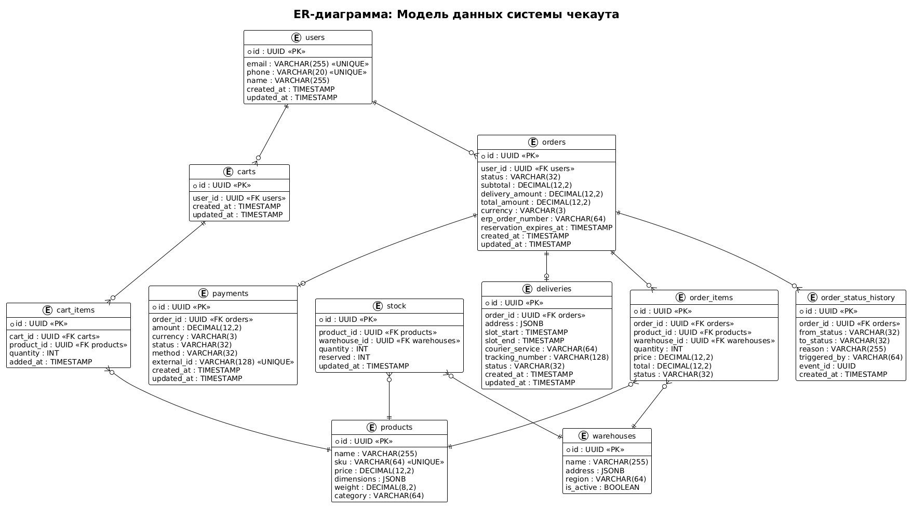

# 11. Модель данных

## 11.1. Назначение документа

Раздел описывает модель данных системы оформления заказа. Документ содержит:

- ER-диаграмму (PlantUML).
- Описание всех таблиц с полями, типами и ограничениями.
- Связи между таблицами.
- Индексы и их обоснование.
- Партиционирование.
- Миграции и версионирование схемы.
- Требования к производительности.

**СУБД:** PostgreSQL 14.
**Стандарт:** 3-я нормальная форма (3NF).
**Инструмент моделирования:** PlantUML.

---

## 11.2. Принципы проектирования

| Принцип | Обоснование |
|---------|-------------|
| **3NF** | Минимизация дублирования данных |
| **UUID как PK** | Устойчивость к распределённой генерации |
| **TIMESTAMP with TZ** | Корректная работа с часовыми поясами |
| **JSONB для гибких полей** | Адреса, габариты, метаданные |
| **Мягкое удаление** | `deleted_at` вместо физического удаления |
| **Аудит** | `created_at`, `updated_at` во всех таблицах |
| **Индексы на FK** | Ускорение JOIN-ов |
| **Уникальные индексы** | Защита от дублей |

---
### 11.3. ER-диаграмма



Исходник: [er-diagram.puml](../diagrams/er-diagram.puml)

## 11.4. Описание таблиц

### 11.4.1. `users` — Пользователи

| Поле | Тип | Ограничения | Описание |
|------|-----|-------------|----------|
| id | UUID | PK | Идентификатор |
| email | VARCHAR(255) | UNIQUE, NOT NULL | Email |
| phone | VARCHAR(20) | UNIQUE | Телефон |
| name | VARCHAR(255) | | Имя |
| created_at | TIMESTAMPTZ | NOT NULL, DEFAULT NOW() | Дата создания |
| updated_at | TIMESTAMPTZ | NOT NULL, DEFAULT NOW() | Дата обновления |

**Индексы:**
- `idx_users_email` (UNIQUE) — поиск по email.
- `idx_users_phone` (UNIQUE) — поиск по телефону.

---

### 11.4.2. `carts` — Корзины

| Поле | Тип | Ограничения | Описание |
|------|-----|-------------|----------|
| id | UUID | PK | Идентификатор корзины |
| user_id | UUID | FK → users.id, NOT NULL | Владелец |
| created_at | TIMESTAMPTZ | NOT NULL | Дата создания |
| updated_at | TIMESTAMPTZ | NOT NULL | Дата обновления |

**Индексы:**
- `idx_carts_user_id` — поиск корзины пользователя.

**Бизнес-правило:** у одного пользователя может быть только одна активная корзина.

---

### 11.4.3. `cart_items` — Позиции корзины

| Поле | Тип | Ограничения | Описание |
|------|-----|-------------|----------|
| id | UUID | PK | Идентификатор |
| cart_id | UUID | FK → carts.id, NOT NULL | Корзина |
| product_id | UUID | FK → products.id, NOT NULL | Товар |
| quantity | INT | NOT NULL, CHECK (quantity > 0 AND quantity <= 99) | Количество |
| added_at | TIMESTAMPTZ | NOT NULL | Дата добавления |

**Индексы:**
- `idx_cart_items_cart_id` — все позиции корзины.
- `idx_cart_items_product_id` — поиск по товару.
- `unique_cart_product` (UNIQUE cart_id, product_id) — нельзя добавить один товар дважды.

**Бизнес-правило:** максимум 50 позиций в корзине.

---

### 11.4.4. `orders` — Заказы

| Поле | Тип | Ограничения | Описание |
|------|-----|-------------|----------|
| id | UUID | PK | Идентификатор заказа |
| user_id | UUID | FK → users.id, NOT NULL | Клиент |
| status | VARCHAR(32) | NOT NULL | Статус заказа |
| subtotal | DECIMAL(12,2) | NOT NULL | Сумма без доставки |
| delivery_amount | DECIMAL(12,2) | NOT NULL | Стоимость доставки |
| total_amount | DECIMAL(12,2) | NOT NULL | Итоговая сумма |
| currency | VARCHAR(3) | NOT NULL, DEFAULT 'RUB' | Валюта |
| erp_order_number | VARCHAR(64) | | Номер в ERP |
| reservation_expires_at | TIMESTAMPTZ | | Время истечения резерва |
| idempotency_key | VARCHAR(64) | UNIQUE | Ключ идемпотентности |
| created_at | TIMESTAMPTZ | NOT NULL | Дата создания |
| updated_at | TIMESTAMPTZ | NOT NULL | Дата обновления |

**Индексы:**
- `idx_orders_user_id` — заказы пользователя.
- `idx_orders_status` — заказы по статусу (для мониторинга).
- `idx_orders_created_at` — сортировка по дате.
- `idx_orders_reservation_expires_at` — поиск «зависших» резервов.
- `idx_orders_idempotency_key` (UNIQUE) — защита от дублей.

**Партиционирование:** по `created_at`, раз в месяц (см. раздел 11.6).

**Бизнес-правила:**
- `total_amount = subtotal + delivery_amount`.
- `reservation_expires_at = created_at + 15 минут`.

---

### 11.4.5. `order_items` — Позиции заказа

| Поле | Тип | Ограничения | Описание |
|------|-----|-------------|----------|
| id | UUID | PK | Идентификатор |
| order_id | UUID | FK → orders.id, NOT NULL | Заказ |
| product_id | UUID | FK → products.id, NOT NULL | Товар |
| warehouse_id | UUID | FK → warehouses.id | Склад отгрузки |
| quantity | INT | NOT NULL, CHECK (quantity > 0) | Количество |
| price | DECIMAL(12,2) | NOT NULL | Цена на момент заказа |
| total | DECIMAL(12,2) | NOT NULL | Стоимость позиции |
| status | VARCHAR(32) | NOT NULL, DEFAULT 'RESERVED' | Статус позиции |

**Индексы:**
- `idx_order_items_order_id` — все позиции заказа.
- `idx_order_items_product_id` — поиск по товару.
- `idx_order_items_warehouse_id` — поиск по складу (для сплитования).

---

### 11.4.6. `order_status_history` — История статусов

| Поле | Тип | Ограничения | Описание |
|------|-----|-------------|----------|
| id | UUID | PK | Идентификатор |
| order_id | UUID | FK → orders.id, NOT NULL | Заказ |
| from_status | VARCHAR(32) | | Предыдущий статус |
| to_status | VARCHAR(32) | NOT NULL | Новый статус |
| reason | VARCHAR(255) | | Причина |
| triggered_by | VARCHAR(64) | | Кто инициировал |
| event_id | UUID | UNIQUE | ID события (для идемпотентности) |
| created_at | TIMESTAMPTZ | NOT NULL | Дата перехода |

**Индексы:**
- `idx_status_history_order_id` — история заказа.
- `idx_status_history_event_id` (UNIQUE) — идемпотентность.
- `idx_status_history_created_at` — аналитика.

**Партиционирование:** по `created_at`, раз в месяц.

---

### 11.4.7. `payments` — Платежи

| Поле | Тип | Ограничения | Описание |
|------|-----|-------------|----------|
| id | UUID | PK | Идентификатор |
| order_id | UUID | FK → orders.id, NOT NULL | Заказ |
| amount | DECIMAL(12,2) | NOT NULL | Сумма |
| currency | VARCHAR(3) | NOT NULL, DEFAULT 'RUB' | Валюта |
| status | VARCHAR(32) | NOT NULL | Статус платежа |
| method | VARCHAR(32) | NOT NULL | Способ оплаты |
| external_id | VARCHAR(128) | UNIQUE | ID в шлюзе |
| created_at | TIMESTAMPTZ | NOT NULL | Дата создания |
| updated_at | TIMESTAMPTZ | NOT NULL | Дата обновления |

**Индексы:**
- `idx_payments_order_id` — платежи заказа.
- `idx_payments_external_id` (UNIQUE) — идемпотентность webhook.
- `idx_payments_status` — мониторинг.

**Статусы:** `INIT`, `PENDING`, `SUCCESS`, `FAILED`, `REFUNDED`.

---

### 11.4.8. `deliveries` — Доставки

| Поле | Тип | Ограничения | Описание |
|------|-----|-------------|----------|
| id | UUID | PK | Идентификатор |
| order_id | UUID | FK → orders.id, NOT NULL | Заказ |
| address | JSONB | NOT NULL | Адрес доставки |
| slot_start | TIMESTAMPTZ | NOT NULL | Начало интервала |
| slot_end | TIMESTAMPTZ | NOT NULL | Конец интервала |
| courier_service | VARCHAR(64) | | Курьерская служба |
| tracking_number | VARCHAR(128) | | Трек-номер |
| status | VARCHAR(32) | NOT NULL | Статус доставки |
| created_at | TIMESTAMPTZ | NOT NULL | Дата создания |
| updated_at | TIMESTAMPTZ | NOT NULL | Дата обновления |

**Структура `address`:**
```json
{
  "city": "Набережные Челны",
  "street": "Проспект Мира",
  "house": "10",
  "apartment": "42",
  "postal_code": "423800",
  "country": "RU"
}
```

**Индексы:**
- `idx_deliveries_order_id` — доставки заказа.
- `idx_deliveries_tracking_number` — поиск по треку.
- `idx_deliveries_status` — мониторинг.
- `idx_deliveries_slot_start` — планирование.

**Статусы:** `PENDING`, `ASSIGNED`, `IN_TRANSIT`, `DELIVERED`, `CANCELLED`.

---

### 11.4.9. `products` — Товары

| Поле | Тип | Ограничения | Описание |
|------|-----|-------------|----------|
| id | UUID | PK | Идентификатор |
| name | VARCHAR(255) | NOT NULL | Название |
| sku | VARCHAR(64) | UNIQUE, NOT NULL | Артикул |
| price | DECIMAL(12,2) | NOT NULL | Цена |
| dimensions | JSONB | | Габариты |
| weight | DECIMAL(8,2) | | Вес (кг) |
| category | VARCHAR(64) | | Категория |

**Структура `dimensions`:**
```json
{
  "length_cm": 120,
  "width_cm": 60,
  "height_cm": 75
}
```

**Индексы:**
- `idx_products_sku` (UNIQUE) — поиск по артикулу.
- `idx_products_category` — фильтрация.

---

### 11.4.10. `warehouses` — Склады

| Поле | Тип | Ограничения | Описание |
|------|-----|-------------|----------|
| id | UUID | PK | Идентификатор |
| name | VARCHAR(255) | NOT NULL | Название |
| address | JSONB | NOT NULL | Адрес |
| region | VARCHAR(64) | | Регион |
| is_active | BOOLEAN | NOT NULL, DEFAULT TRUE | Активен |

**Индексы:**
- `idx_warehouses_region` — фильтрация по региону.
- `idx_warehouses_is_active` — только активные.

---

### 11.4.11. `stock` — Остатки

| Поле | Тип | Ограничения | Описание |
|------|-----|-------------|----------|
| id | UUID | PK | Идентификатор |
| product_id | UUID | FK → products.id, NOT NULL | Товар |
| warehouse_id | UUID | FK → warehouses.id, NOT NULL | Склад |
| quantity | INT | NOT NULL, DEFAULT 0 | Доступное количество |
| reserved | INT | NOT NULL, DEFAULT 0 | Зарезервировано |
| updated_at | TIMESTAMPTZ | NOT NULL | Дата обновления |

**Индексы:**
- `idx_stock_product_warehouse` (UNIQUE product_id, warehouse_id) — уникальность.
- `idx_stock_product_id` — остатки товара.

**Бизнес-правило:** `quantity >= reserved`.

---

## 11.5. Индексы: сводка

| Таблица | Индекс | Тип | Назначение |
|---------|--------|-----|------------|
| users | idx_users_email | UNIQUE B-tree | Поиск по email |
| users | idx_users_phone | UNIQUE B-tree | Поиск по телефону |
| carts | idx_carts_user_id | B-tree | Корзина пользователя |
| cart_items | unique_cart_product | UNIQUE B-tree | Защита от дублей |
| orders | idx_orders_user_id | B-tree | Заказы пользователя |
| orders | idx_orders_status | B-tree | Мониторинг |
| orders | idx_orders_created_at | B-tree | Сортировка |
| orders | idx_orders_idempotency_key | UNIQUE B-tree | Идемпотентность |
| order_items | idx_order_items_order_id | B-tree | Позиции заказа |
| order_status_history | idx_status_history_event_id | UNIQUE B-tree | Идемпотентность |
| payments | idx_payments_external_id | UNIQUE B-tree | Идемпотентность webhook |
| deliveries | idx_deliveries_tracking_number | B-tree | Поиск по треку |
| stock | idx_stock_product_warehouse | UNIQUE B-tree | Уникальность |

---

## 11.6. Партиционирование

### 11.6.1. Стратегия

| Таблица | Стратегия | Ключ | Интервал |
|---------|-----------|------|----------|
| orders | RANGE | created_at | Месяц |
| order_items | RANGE | (через order_id) | Месяц |
| order_status_history | RANGE | created_at | Месяц |
| payments | RANGE | created_at | Месяц |

### 11.6.2. Обоснование

- **Объём:** ~50 000 заказов в сутки → 1,5 млн в месяц.
- **Retention:** активные данные — 12 месяцев, архив — 5 лет.
- **Преимущества:**
  - Быстрый поиск по дате (partition pruning).
  - Простое удаление старых данных (DROP PARTITION).
  - Меньший размер индексов.

### 11.6.3. Пример создания партиции

```sql
CREATE TABLE orders (
    id UUID NOT NULL,
    user_id UUID NOT NULL,
    status VARCHAR(32) NOT NULL,
    total_amount DECIMAL(12,2) NOT NULL,
    created_at TIMESTAMPTZ NOT NULL,
    ...
) PARTITION BY RANGE (created_at);

CREATE TABLE orders_2026_10 PARTITION OF orders
    FOR VALUES FROM ('2026-10-01') TO ('2026-11-01');

CREATE TABLE orders_2026_11 PARTITION OF orders
    FOR VALUES FROM ('2026-11-01') TO ('2026-12-01');
```

**Автоматизация:** pg_partman создаёт партиции заранее (за 2 месяца вперёд).

---

## 11.7. Миграции

### 11.7.1. Инструмент

**Flyway** — версионирование схемы БД.

**Принципы:**
- Все миграции — в Git.
- Именование: `V{version}__{description}.sql`.
- Только forward-only (без rollback).
- Тестирование на stage перед prod.

### 11.7.2. Пример структуры миграций

```
db/migration/
├── V1__create_users.sql
├── V2__create_carts.sql
├── V3__create_products.sql
├── V4__create_orders.sql
├── V5__create_order_items.sql
├── V6__create_payments.sql
├── V7__create_deliveries.sql
├── V8__create_status_history.sql
├── V9__add_indexes.sql
├── V10__add_partitioning.sql
└── V11__add_idempotency_key.sql
```

### 11.7.3. Правила безопасных миграций

| Правило | Обоснование |
|---------|-------------|
| Не удалять столбцы сразу | Только через 2 релиза |
| Добавлять столбцы с DEFAULT | Избежать NULL |
| Не блокировать таблицу | Использовать CONCURRENTLY |
| Добавлять индексы CONCURRENTLY | Без блокировки |
| Разделять большие миграции | По одной операции |

---

## 11.8. Требования к производительности

| Операция | Целевое время (p95) | Индекс |
|----------|---------------------|--------|
| Получить корзину | ≤ 50 мс | idx_carts_user_id |
| Добавить в корзину | ≤ 100 мс | unique_cart_product |
| Создать заказ | ≤ 200 мс | — |
| Получить заказ по ID | ≤ 50 мс | PK |
| Получить заказы пользователя | ≤ 150 мс | idx_orders_user_id |
| Найти зависшие резервы | ≤ 200 мс | idx_orders_reservation_expires_at |
| Проверить остатки | ≤ 80 мс | idx_stock_product_warehouse |
| Сохранить событие | ≤ 50 мс | idx_status_history_event_id |

---

## 11.9. Резервное копирование

### 11.9.1. Стратегия

| Тип | Частота | Retention |
|-----|---------|-----------|
| Full backup | Ежедневно | 30 дней |
| Incremental (WAL) | Непрерывно | 7 дней |
| Snapshot | Перед релизом | 90 дней |

### 11.9.2. RPO / RTO

- **RPO (Recovery Point Objective):** ≤ 5 минут.
- **RTO (Recovery Time Objective):** ≤ 15 минут.

### 11.9.3. Репликация

- **Primary** — запись.
- **2 read-replicas** — чтение, отказоустойчивость.
- **Streaming replication** — асинхронная.

---

## 11.10. Безопасность данных

| Аспект | Мера |
|--------|------|
| Персональные данные | Шифрование на уровне колонок (pgcrypto) |
| Платёжные данные | Не хранятся (токенизация) |
| Пароли | Не хранятся (только hash в Auth Service) |
| Аудит | `order_status_history` |
| Доступ | Разграничение по ролям (RBAC) |
| Соответствие | 152-ФЗ (серверы в РФ) |
