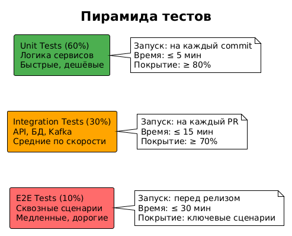
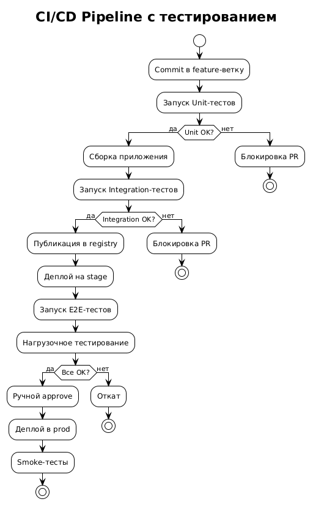

# 12. Тестирование

## 12.1. Назначение документа

Раздел описывает стратегию тестирования системы оформления заказа. Документ содержит:

- Цели и принципы тестирования.
- Уровни тестирования (пирамида тестов).
- Виды тестирования (функциональное, интеграционное, нагрузочное, безопасности).
- Тест-кейсы по Use Cases.
- Тестовые данные.
- Автоматизация тестирования.
- UAT (User Acceptance Testing).
- Метрики качества и критерии выхода в прод.

**Цель:** обеспечить надёжность чекаута, исключить дубли заказов, гарантировать корректность интеграций.

---

## 12.2. Цели тестирования

| № | Цель | Метрика |
|---|------|---------|
| 1 | Убедиться, что все FR реализованы | 100% покрытие FR тестами |
| 2 | Проверить корректность интеграций | Все контракты протестированы |
| 3 | Обеспечить производительность | p95 ≤ NFR |
| 4 | Исключить регрессии | Автотесты на каждый релиз |
| 5 | Проверить безопасность | Пентест + аудит |
| 6 | Убедиться в отказоустойчивости | Chaos-тесты |

---

## 12.3. Принципы тестирования

| Принцип | Обоснование |
|---------|-------------|
| **Раннее тестирование** | Сдвиг влево (shift-left) — тесты пишутся вместе с кодом |
| **Пирамида тестов** | Много unit, меньше integration, ещё меньше E2E |
| **Автоматизация** | 80% тестов автоматизированы |
| **Независимость** | Тесты не зависят друг от друга |
| **Воспроизводимость** | Одинаковый результат при каждом запуске |
| **Изоляция данных** | Каждый тест работает со своими данными |
| **Быстрота** | Unit-тесты ≤ 5 мин, E2E ≤ 30 мин |

---
### 12.4. Пирамида тестов

Исходник: [test-pyramid.puml](../diagrams/test-pyramid.puml)

| Уровень | Доля | Что проверяет | Инструменты |
|---------|------|---------------|-------------|
| Unit | 60% | Логика сервисов, утилиты | JUnit, Mockito, Kotest |
| Integration | 30% | API, БД, Kafka | Testcontainers, REST Assured |
| E2E | 10% | Сквозные сценарии | Selenium, Playwright, Karate |
---
## 12.5. Виды тестирования

### 12.5.1. Функциональное тестирование

| Вид | Что проверяет | Инструмент |
|-----|---------------|------------|
| Unit | Отдельные методы и классы | JUnit, Mockito |
| Component | Отдельный сервис | Spring Boot Test |
| Integration | Взаимодействие сервисов | Testcontainers, REST Assured |
| E2E | Полный путь клиента | Playwright, Karate |
| API | Контракты API | Postman, Karate, Pact |

### 12.5.2. Нефункциональное тестирование

| Вид | Что проверяет | Инструмент |
|-----|---------------|------------|
| Нагрузочное | Производительность под нагрузкой | JMeter, Gatling, k6 |
| Стресс-тестирование | Поведение при пиковой нагрузке | Gatling |
| Тестирование безопасности | Уязвимости | OWASP ZAP, Burp Suite |
| Chaos-тестирование | Отказоустойчивость | Chaos Monkey, Litmus |
| Usability | Удобство интерфейса | Ручное тестирование |
| Совместимость | Разные устройства и браузеры | BrowserStack |

### 12.5.3. Регрессионное тестирование

**Цель:** убедиться, что новые изменения не сломали существующий функционал.

**Подход:**
- Полный прогон автотестов на каждый релиз.
- Smoke-тесты после деплоя.
- Регрессионный набор — 500+ автотестов.

---

## 12.6. Тест-кейсы по Use Cases

### 12.6.1. UC-01: Оформление заказа (основной поток)

| ID | Название | Шаги | Ожидаемый результат | Приоритет |
|----|----------|------|---------------------|-----------|
| TC-01 | Успешное оформление заказа | 1. Добавить товар 2. Открыть корзину 3. Выбрать слот 4. Оплатить 5. Проверить заказ | Заказ создан в ERP, статус `CONFIRMED`, клиент получил уведомление | Critical |
| TC-02 | Расчёт корзины с доставкой | 1. Добавить товары 2. Открыть корзину | Стоимость и слоты рассчитаны корректно | Critical |
| TC-03 | Резервирование товара | 1. Оформить заказ 2. Проверить резерв | Резерв создан на 15 минут | Critical |

### 12.6.2. UC-01.A: Товара нет на складе

| ID | Название | Шаги | Ожидаемый результат | Приоритет |
|----|----------|------|---------------------|-----------|
| TC-04 | Товар отсутствует при открытии корзины | 1. Добавить товар 2. Сделать товар недоступным 3. Открыть корзину | Показано «Товар закончился», кнопка «Оформить» неактивна | High |
| TC-05 | Товара не хватило при резервировании | 1. Оформить заказ 2. Обесточить товар 3. Нажать «Оплатить» | Ответ `409 RESERVATION_FAILED`, заказ не создан | Critical |
| TC-06 | Альтернативный склад | 1. Товара нет на основном складе 2. Открыть корзину | Показан альтернативный склад | Medium |

### 12.6.3. UC-01.B: Оплата не прошла

| ID | Название | Шаги | Ожидаемый результат | Приоритет |
|----|----------|------|---------------------|-----------|
| TC-07 | Оплата отклонена банком | 1. Оформить заказ 2. Имитировать `payment.failed` | Статус `PAYMENT_FAILED`, клиент получил сообщение | Critical |
| TC-08 | Клиент повторил оплату | 1. После `PAYMENT_FAILED` 2. Нажать «Попробовать снова» 3. Оплатить | Новый платёж создан, заказ перешёл в `PAID` | High |
| TC-09 | Клиент отменил после неудачи | 1. После `PAYMENT_FAILED` 2. Нажать «Отменить» | Заказ `CANCELLED`, резерв снят | High |
| TC-10 | Таймаут 15 минут | 1. Создать заказ 2. Не оплачивать 15 минут | Заказ `EXPIRED`, резерв снят автоматически | Critical |

### 12.6.4. UC-01.C: Отмена после оплаты

| ID | Название | Шаги | Ожидаемый результат | Приоритет |
|----|----------|------|---------------------|-----------|
| TC-11 | Отмена оплаченного заказа | 1. Оплатить заказ 2. Нажать «Отменить» | Статус `REFUND_PENDING`, возврат инициирован | Critical |
| TC-12 | Отмена невозможна в IN_TRANSIT | 1. Заказ в статусе `IN_TRANSIT` 2. Попробовать отменить | Ответ `409 CANCELLATION_NOT_ALLOWED` | High |
| TC-13 | Возврат средств | 1. Отменить оплаченный заказ 2. Дождаться webhook | Статус `CANCELLED`, событие `refund.completed` | Critical |

### 12.6.5. Идемпотентность

| ID | Название | Шаги | Ожидаемый результат | Приоритет |
|----|----------|------|---------------------|-----------|
| TC-14 | Двойное нажатие «Оплатить» | 1. Быстро нажать «Оплатить» 2 раза | Создан 1 заказ, второй запрос вернул тот же результат | Critical |
| TC-15 | Дублирование webhook | 1. Отправить webhook 2 раза с одним `payment_id` | Обработан 1 раз, статус не меняется | Critical |
| TC-16 | Дублирование события Kafka | 1. Отправить `order.confirmed` 2 раза | Обработан 1 раз (по `event_id`) | Critical |

### 12.6.6. Обработка ошибок

| ID | Название | Шаги | Ожидаемый результат | Приоритет |
|----|----------|------|---------------------|-----------|
| TC-17 | ERP недоступна | 1. Отключить ERP 2. Открыть корзину | Ответ `503`, сообщение «Сервис временно недоступен» | High |
| TC-18 | Payment Gateway недоступен | 1. Отключить Payment Gateway 2. Оформить заказ | Retry 3 раза, затем `PAYMENT_FAILED` | High |
| TC-19 | Слот недоступен | 1. Выбрать занятый слот 2. Подтвердить | Ответ `409 SLOT_UNAVAILABLE` с альтернативами | Medium |
| TC-20 | Некорректная подпись webhook | 1. Отправить webhook с неверной подписью | Ответ `400 INVALID_SIGNATURE` | High |

### 12.6.7. Уведомления

| ID | Название | Шаги | Ожидаемый результат | Приоритет |
|----|----------|------|---------------------|-----------|
| TC-21 | Push после создания заказа | 1. Оформить заказ | Клиент получил push | Medium |
| TC-22 | Push после оплаты | 1. Оплатить заказ | Клиент получил push | Medium |
| TC-23 | SMS после передачи курьеру | 1. Передать заказ курьеру | Клиент получил SMS | Medium |

### 12.6.8. Производительность

| ID | Название | Условие | Ожидаемый результат | Приоритет |
|----|----------|---------|---------------------|-----------|
| TC-24 | Нагрузка на расчёт корзины | 500 RPS | p95 ≤ 1,5 сек | Critical |
| TC-25 | Нагрузка на чекаут | 500 RPS | p95 ≤ 2 сек | Critical |
| TC-26 | Поток Kafka | 10 000 событий/час | Без потерь, lag ≤ 100 | Critical |
| TC-27 | Одновременные пользователи | 10 000 | Без ошибок 5xx | High |

### 12.6.9. Безопасность

| ID | Название | Проверка | Ожидаемый результат | Приоритет |
|----|----------|----------|---------------------|-----------|
| TC-28 | Без токена | Запрос без `Authorization` | Ответ `401` | Critical |
| TC-29 | Чужой заказ | Запрос заказа другого пользователя | Ответ `403` | Critical |
| TC-30 | SQL-инъекция | Передать `'; DROP TABLE` | Запрос отклонён | Critical |
| TC-31 | XSS | Передать `<script>` в поле | Экранировано | High |
| TC-32 | Rate limiting | 200 RPS на пользователя | Ответ `429` | High |

**Итого:** 32 тест-кейса, из которых 18 Critical, 10 High, 4 Medium.

---

## 12.7. Тестовые данные

### 12.7.1. Принципы

- **Анонимизация:** никаких реальных ПДн.
- **Изоляция:** каждый тест — свои данные.
- **Генерация:** Faker для генерации данных.
- **Откат:** после теста данные удаляются.

### 12.7.2. Тестовые пользователи

| Тип | Описание |
|-----|----------|
| `user_new` | Новый пользователь без заказов |
| `user_with_cart` | Пользователь с товарами в корзине |
| `user_with_orders` | Пользователь с историей заказов |
| `user_blocked` | Заблокированный пользователь |

### 12.7.3. Тестовые товары

| SKU | Название | Особенность |
|-----|----------|-------------|
| `TEST-001` | Обычный товар | В наличии |
| `TEST-002` | Товар без остатка | `quantity = 0` |
| `TEST-003` | Крупногабарит | Габариты > 100 см |
| `TEST-004` | Товар на дальнем складе | Сплитование |

### 12.7.4. Тестовые карты

| Карта | Результат |
|-------|-----------|
| `4111 1111 1111 1111` | Успешная оплата |
| `4000 0000 0000 0002` | Отклонена |
| `4000 0000 0000 9995` | Недостаточно средств |

---

## 12.8. Автоматизация тестирования

### 12.8.1. Стек

| Уровень | Инструмент |
|---------|-----------|
| Unit | JUnit 5, Mockito, Kotest |
| Integration | Testcontainers, REST Assured |
| Contract | Pact |
| E2E | Playwright, Karate |
| Load | Gatling, k6 |
| Security | OWASP ZAP |

### 12.8.2. CI/CD интеграция

Исходник: [cicd-pipeline.puml](../diagrams/cicd-pipeline.puml)

### 12.8.3. Правила

- **Pre-commit:** unit-тесты локально.
- **PR:** unit + integration.
- **Merge в main:** unit + integration + contract.
- **Перед релизом:** E2E + нагрузочные + security.
- **После деплоя:** smoke-тесты.

---

## 12.9. UAT (User Acceptance Testing)

### 12.9.1. Цель

Убедиться, что система соответствует ожиданиям бизнеса и готова к продакшену.

### 12.9.2. Участники

| Роль | Ответственность |
|------|-----------------|
| Product Owner | Приёмка функционала |
| Бизнес-заказчик | Проверка бизнес-сценариев |
| QA Lead | Координация UAT |
| Системный аналитик | Разбор замечаний |

### 12.9.3. Сценарии UAT

| ID | Сценарий | Ответственный |
|----|----------|---------------|
| UAT-01 | Оформление заказа обычным клиентом | Бизнес |
| UAT-02 | Оформление крупногабаритного заказа | Бизнес |
| UAT-03 | Оплата несколькими способами | Финансы |
| UAT-04 | Отмена и возврат | Финансы |
| UAT-05 | Сплитование заказа | Логистика |
| UAT-06 | Уведомления клиенту | Клиентский сервис |

### 12.9.4. Критерии приёмки UAT

- Все UAT-сценарии пройдены.
- 0 Critical и 0 High багов.
- Подпись Product Owner.

---

## 12.10. Метрики качества

### 12.10.1. Покрытие

| Метрика | Целевое значение |
|---------|------------------|
| Покрытие Unit-тестами | ≥ 80% |
| Покрытие Integration-тестами | ≥ 70% |
| Покрытие критических путей E2E | 100% |

### 12.10.2. Качество

| Метрика | Целевое значение |
|---------|------------------|
| Количество багов на релиз | ≤ 5 |
| Critical баги в проде | 0 |
| Время на fix Critical | ≤ 24 часа |
| Регрессионные баги | ≤ 2% |

### 12.10.3. Скорость

| Метрика | Целевое значение |
|---------|------------------|
| Время Unit-тестов | ≤ 5 мин |
| Время Integration | ≤ 15 мин |
| Время E2E | ≤ 30 мин |
| Время полного CI/CD | ≤ 60 мин |

---

## 12.11. Критерии выхода в прод (Definition of Done)

- ✅ Все FR покрыты тестами.
- ✅ Покрытие Unit ≥ 80%.
- ✅ Все Critical тесты пройдены.
- ✅ Нагрузочное тестирование пройдено (NFR).
- ✅ Security-сканирование без Critical уязвимостей.
- ✅ UAT подписан Product Owner.
- ✅ Smoke-тесты после деплоя пройдены.
- ✅ Мониторинг и алерты настроены.
- ✅ Rollback-план готов.

---

## 12.12. Управление дефектами

### 12.12.1. Классификация багов

| Severity | Описание | SLA |
|----------|----------|-----|
| **Critical** | Полная потеря функционала, дубли заказов | Fix ≤ 4 часа |
| **High** | Часть функционала не работает | Fix ≤ 24 часа |
| **Medium** | Работает, но с ограничениями | Fix ≤ 3 дней |
| **Low** | Косметика, не влияет на бизнес | Fix ≤ 2 недель |

