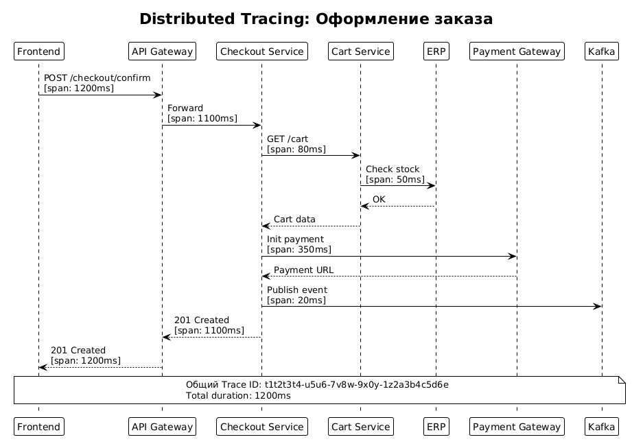

# 13. Мониторинг и Observability

## 13.1. Назначение документа

Раздел описывает систему мониторинга и observability для чекаута. Документ содержит:

- Цели мониторинга.
- SLO / SLI / SLA.
- Ключевые метрики (Golden Signals).
- Стратегию логирования.
- Распределённый трейсинг.
- Алерты и их пороги.
- Дашборды Grafana.
- Инструменты мониторинга.
- Runbook для дежурного инженера.

**Цель:** обеспечить видимость работы системы, быстро обнаруживать и устранять инциденты, поддерживать SLA 99,95%.

---

## 13.2. Цели мониторинга

| № | Цель | Метрика |
|---|------|---------|
| 1 | Обнаруживать инциденты до жалоб клиентов | MTTR ≤ 15 мин |
| 2 | Понимать состояние системы в реальном времени | Дашборды с latency 30 сек |
| 3 | Отслеживать SLA/SLO | 99,95% доступности |
| 4 | Разбирать инциденты постфактум | Retention логов 30 дней |
| 5 | Прогнозировать проблемы | Алерты до отказа |
| 6 | Обеспечить трассировку запросов | Correlation ID во всех сервисах |

---

## 13.3. SLO / SLI / SLA

### 13.3.1. Определения

- **SLI (Service Level Indicator)** — измеряемая метрика (например, latency).
- **SLO (Service Level Objective)** — целевое значение SLI (например, p95 ≤ 1,5 сек).
- **SLA (Service Level Agreement)** — обязательство перед клиентом (например, 99,95% доступности).

### 13.3.2. SLI / SLO по сервисам

| Сервис | SLI | SLO | SLA |
|--------|-----|-----|-----|
| **Cart Service** | Latency p95 | ≤ 1,5 сек | 99,95% |
| **Cart Service** | Availability | 99,95% | 99,95% |
| **Checkout Service** | Latency p95 | ≤ 2 сек | 99,95% |
| **Checkout Service** | Error rate | ≤ 0,5% | — |
| **Checkout Service** | Availability | 99,95% | 99,95% |
| **Logistics Service** | Latency p95 | ≤ 1 сек | 99,9% |
| **Payment Gateway** | Success rate | ≥ 98% | 99,9% |
| **Kafka** | Consumer Lag | ≤ 1000 | — |
| **PostgreSQL** | Query latency p95 | ≤ 100 мс | — |
| **API Gateway** | Latency p95 | ≤ 200 мс | 99,99% |

### 13.3.3. Error Budget

**Error Budget** = 100% − SLO = 0,05% от общего времени.

- В месяц: 0,05% × 30 дней × 24 часа = **21,6 минуты** недоступности.
- Если бюджет исчерпан — стоп на новые фичи, фокус на надёжность.

### 13.3.4. Burn Rate

| Burn Rate | Порог | Действие |
|-----------|-------|----------|
| 1x | Норма | Мониторинг |
| 2x | Warning | Уведомление команды |
| 5x | Critical | PagerDuty, стоп релизов |
| 14x | Emergency | Все на разбор инцидента |

---

## 13.4. Golden Signals (ключевые метрики)

### 13.4.1. Четыре золотых сигнала

| Сигнал | Описание | Метрики |
|--------|----------|---------|
| **Latency** | Время ответа | p50, p95, p99 |
| **Traffic** | Нагрузка | RPS, количество запросов |
| **Errors** | Ошибки | 4xx, 5xx, error rate |
| **Saturation** | Насыщение | CPU, RAM, connections, disk |

### 13.4.2. Метрики по сервисам

| Метрика | Источник | Retention |
|---------|----------|-----------|
| `http_requests_total` | Spring Actuator | 1 год |
| `http_request_duration_seconds` | Spring Actuator | 1 год |
| `http_requests_errors_total` | Spring Actuator | 1 год |
| `jvm_memory_used_bytes` | Micrometer | 1 год |
| `jvm_gc_pause_seconds` | Micrometer | 1 год |
| `kafka_consumer_lag` | Kafka Exporter | 1 год |
| `kafka_producer_errors_total` | Kafka Exporter | 1 год |
| `db_connections_active` | PostgreSQL Exporter | 1 год |
| `db_query_duration_seconds` | PostgreSQL Exporter | 1 год |
| `redis_hits_total` | Redis Exporter | 1 год |
| `business_orders_created_total` | Custom | 5 лет |
| `business_orders_completed_total` | Custom | 5 лет |
| `business_payment_success_total` | Custom | 5 лет |
| `business_payment_failed_total` | Custom | 5 лет |
| `business_cart_conversion_rate` | Custom | 5 лет |

### 13.4.3. Бизнес-метрики

| Метрика | Описание | Целевое значение |
|---------|----------|------------------|
| Конверсия корзины | % оформленных корзин | ≥ 60% |
| Успешные оплаты | % успешных платежей | ≥ 95% |
| Доля отмен | % отменённых заказов | ≤ 15% |
| Средний чек | Сумма заказа | ≥ 5 000 ₽ |
| Время оформления | От корзины до оплаты | ≤ 3 мин |
| Доля EXPIRED | Заказы с истёкшим резервом | ≤ 5% |

---

## 13.5. Логирование

### 13.5.1. Принципы

- **Structured JSON** — все логи в формате JSON.
- **Correlation ID** — единый ID для запроса через все сервисы.
- **Уровни:** DEBUG, INFO, WARN, ERROR.
- **Никаких ПДн** — не логируем номера карт, пароли, токены.
- **Централизация** — ELK Stack (Elasticsearch + Logstash + Kibana).

### 13.5.2. Формат лога

```json
{
  "timestamp": "2026-10-16T12:00:00.123Z",
  "level": "INFO",
  "service": "checkout-service",
  "version": "1.5.2",
  "correlation_id": "c1c2c3c4-d5d6-7e8f-9a0b-1c2d3e4f5a6b",
  "trace_id": "t1t2t3t4-u5u6-7v8w-9x0y-1z2a3b4c5d6e",
  "span_id": "s1s2s3s4",
  "user_id": "u1u2u3u4-v5v6-7w8x-9y0z-1a2b3c4d5e6f",
  "order_id": "o1o2o3o4-p5q6-7r8s-9t0u-1v2w3x4y5z6a",
  "message": "Order created successfully",
  "duration_ms": 245,
  "http": {
    "method": "POST",
    "path": "/api/v1/checkout/confirm",
    "status": 201
  }
}
```

### 13.5.3. Уровни логирования

| Уровень | Когда использовать |
|---------|-------------------|
| DEBUG | Детали для разработки (не в проде) |
| INFO | Нормальные операции |
| WARN | Подозрительные ситуации |
| ERROR | Ошибки, требующие внимания |
| FATAL | Критические ошибки |

### 13.5.4. Что логируем

| Событие | Уровень | Пример |
|---------|---------|--------|
| Заказ создан | INFO | `Order created` |
| Оплата прошла | INFO | `Payment success` |
| Оплата не прошла | WARN | `Payment failed` |
| ERP недоступна | ERROR | `ERP timeout` |
| DLQ событие | ERROR | `Message moved to DLQ` |
| Webhook получен | INFO | `Webhook received` |
| Ошибка подписи | WARN | `Invalid signature` |

### 13.5.5. Что НЕ логируем

- Номера банковских карт.
- Пароли и токены.
- Полные ПДн (только ID).
- CVV-коды.

### 13.5.6. Retention

| Тип логов | Retention |
|-----------|-----------|
| INFO | 30 дней |
| WARN | 90 дней |
| ERROR | 1 год |
| Audit | 5 лет |

---

## 13.6. Распределённый трейсинг

### 13.6.1. Зачем нужен

Трейсинг показывает **полный путь запроса** через все сервисы:
- Где задерживается?
- Какой сервис виноват в ошибке?
- Сколько времени занял каждый вызов?

### 13.6.2. Стек

- **OpenTelemetry** — стандарт сбора телеметрии.
- **Jaeger** — хранилище и UI для трейсов.
- **Correlation ID** — пробрасывается через все сервисы.

### 13.6.3. Схема трейсинга



Исходник: [tracing-diagram.puml](../diagrams/tracing-diagram.puml)

### 13.6.4. Что видно в Jaeger

| Span | Сервис | Длительность |
|------|--------|--------------|
| POST /checkout/confirm | API Gateway | 1200 ms |
| Forward to Checkout | Checkout Service | 1100 ms |
| GET /cart | Cart Service | 80 ms |
| Check stock | ERP | 50 ms |
| Init payment | Payment Gateway | 350 ms |
| Publish event | Kafka | 20 ms |

### 13.6.5. Правила

- Каждый запрос имеет `trace_id`.
- Каждый сервис генерирует `span_id`.
- Контекст пробрасывается через HTTP-заголовки (`traceparent`).
- Sample rate: 10% в проде, 100% в тестах.

---

## 13.7. Алерты

### 13.7.1. Уровни алертов

| Уровень | Канал | Реакция |
|---------|-------|---------|
| **Critical** | PagerDuty (звонок) | Немедленно, 24/7 |
| **Warning** | Slack #alerts | В рабочее время |
| **Info** | Slack #monitoring | По желанию |

### 13.7.2. Список алертов

| ID | Алерт | Условие | Уровень | Действие |
|----|-------|---------|---------|----------|
| AL-01 | Высокий 5xx | > 1% за 5 мин | Critical | PagerDuty |
| AL-02 | Высокая latency | p95 > 3 сек за 5 мин | Critical | PagerDuty |
| AL-03 | DLQ растёт | > 100 сообщений | Critical | PagerDuty |
| AL-04 | Consumer Lag | > 1000 за 5 мин | Warning | Slack |
| AL-05 | ERP недоступна | 5 ошибок подряд | Critical | PagerDuty |
| AL-06 | Payment Gateway недоступен | 3 ошибки подряд | Critical | PagerDuty |
| AL-07 | БД connections | > 80% пула | Warning | Slack |
| AL-08 | CPU > 80% | 10 мин | Warning | Slack |
| AL-09 | RAM > 85% | 10 мин | Warning | Slack |
| AL-10 | Disk > 80% | — | Warning | Slack |
| AL-11 | Kafka broker недоступен | Мгновенно | Critical | PagerDuty |
| AL-12 | Under-replicated partitions | > 0 за 10 мин | Warning | Slack |
| AL-13 | Резервы «зависли» | > 20 мин | Warning | Slack |
| AL-14 | Успешные оплаты упали | < 90% за 15 мин | Critical | PagerDuty |
| AL-15 | Конверсия корзины упала | < 50% за 1 час | Warning | Slack |

### 13.7.3. Правила алертов

- **Не более 5 алертов в час** на дежурного — иначе alert fatigue.
- **Каждый алерт имеет Runbook** — что делать.
- **Алерты тестируются** — раз в квартал.
- **Постмортем** — после каждого Critical.

---

## 13.8. Дашборды Grafana

### 13.8.1. Список дашбордов

| Дашборд | Для кого | Что показывает |
|---------|----------|----------------|
| **Executive Overview** | Руководство | KPI: конверсия, выручка, SLA |
| **Checkout Overview** | Команда чекаута | Latency, errors, throughput |
| **Cart Service** | Backend | Метрики сервиса корзины |
| **Checkout Service** | Backend | Метрики сервиса чекаута |
| **Logistics Service** | Backend | Метрики логистики |
| **Kafka** | DevOps | Lag, throughput, DLQ |
| **PostgreSQL** | DBA | Connections, queries, replication |
| **Redis** | DevOps | Hits, memory, evictions |
| **Business Metrics** | Аналитика | Заказы, оплаты, отмены |
| **SLO / Error Budget** | SRE | Burn rate, остаток бюджета |

### 13.8.2. Executive Overview

**Панели:**
1. **SLA** — % доступности за 30 дней.
2. **Конверсия корзины** — график за 7 дней.
3. **Заказы в час** — текущий поток.
4. **Успешные оплаты** — % за 24 часа.
5. **Средний чек** — динамика.
6. **Доля отмен** — % за 24 часа.

### 13.8.3. Checkout Overview

**Панели:**
1. **RPS** — запросы в секунду.
2. **Latency p50, p95, p99** — за 24 часа.
3. **Error rate** — 4xx и 5xx.
4. **Active connections** — к БД.
5. **CPU / RAM** — по подам.
6. **JVM GC pause** — паузы сборщика мусора.

### 13.8.4. Kafka Dashboard

**Панели:**
1. **Consumer Lag** — по consumer-группам.
2. **Throughput** — сообщений/сек.
3. **DLQ messages** — количество.
4. **Broker health** — CPU, disk, network.
5. **Under-replicated partitions** — количество.
6. **Producer errors** — количество.

### 13.8.5. SLO Dashboard

**Панели:**
1. **Current SLO** — текущий % доступности.
2. **Error Budget** — остаток.
3. **Burn Rate** — скорость расхода.
4. **Time to exhaustion** — прогноз.

---

## 13.9. Инструменты мониторинга

| Инструмент | Назначение |
|------------|------------|
| **Prometheus** | Сбор метрик |
| **Grafana** | Визуализация и дашборды |
| **Alertmanager** | Маршрутизация алертов |
| **Jaeger** | Распределённый трейсинг |
| **OpenTelemetry** | SDK для сбора телеметрии |
| **ELK Stack** | Централизованные логи |
| **Loki** | Логи (альтернатива ELK) |
| **PagerDuty** | Инцидент-менеджмент |
| **Sentry** | Ошибки приложений |
| **Micrometer** | Метрики в Spring Boot |

---

## 13.10. Runbook для дежурного

### 13.10.1. Что делать при алерте «Высокий 5xx»

1. Открыть дашборд **Checkout Overview**.
2. Посмотреть, какой сервис даёт ошибки.
3. Проверить логи в Kibana по `correlation_id`.
4. Проверить зависимости (ERP, Payment Gateway).
5. Если проблема в коде — откатить релиз.
6. Если проблема во внешней системе — включить Circuit Breaker.
7. Уведомить команду в Slack.

### 13.10.2. Что делать при алерте «DLQ растёт»

1. Открыть **Kafka Dashboard**.
2. Посмотреть содержимое DLQ (`kafka-console-consumer`).
3. Определить причину (schema mismatch, бизнес-ошибка).
4. Исправить баг в consumer.
5. Replay событий из DLQ.
6. Убедиться, что DLQ пуст.

### 13.10.3. Что делать при алерте «ERP недоступна»

1. Проверить статус ERP в мониторинге.
2. Проверить сеть между сервисами.
3. Если ERP недоступна > 5 мин — включить fallback (кэш).
4. Уведомить команду ERP.
5. Логировать все запросы для replay.

### 13.10.4. Что делать при алерте «Payment Gateway недоступен»

1. Проверить статус шлюза на status page.
2. Проверить Retry-логи.
3. Если недоступен > 10 мин — переключиться на резервный шлюз.
4. Уведомить клиентов (banner в приложении).

---

## 13.11. Постмортем

### 13.11.1. Когда проводится

- После каждого **Critical** инцидента.
- После исчерпания **Error Budget**.

### 13.11.2. Структура

1. **Timeline** — что и когда произошло.
2. **Impact** — сколько клиентов пострадало, какая выручка потеряна.
3. **Root Cause** — корневая причина.
4. **Что сработало** — что помогло быстро восстановить.
5. **Что не сработало** — что нужно улучшить.
6. **Action Items** — конкретные задачи с дедлайнами.

### 13.11.3. Принципы

- **Blameless** — без поиска виноватых.
- **Фокус на системах** — не на людях.
- **Конкретные действия** — не общие слова.
- **Публичность** — доступен всей команде.

---

## 13.12. Метрики мониторинга

| Метрика | Целевое значение |
|---------|------------------|
| MTTD (Mean Time To Detect) | ≤ 5 мин |
| MTTR (Mean Time To Recovery) | ≤ 15 мин |
| Количество алертов в неделю | ≤ 20 |
| False positive rate | ≤ 10% |
| Покрытие сервисов мониторингом | 100% |
| Покрытие критических путей алертами | 100% |
| Retention логов | 30 дней |
| Retention метрик | 1 год |

